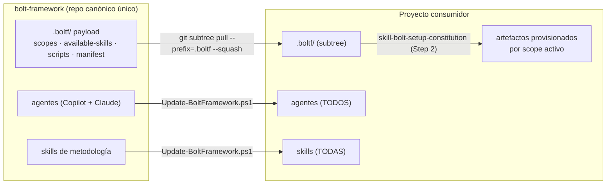
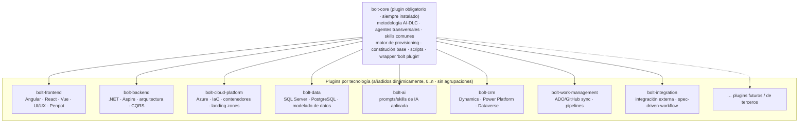
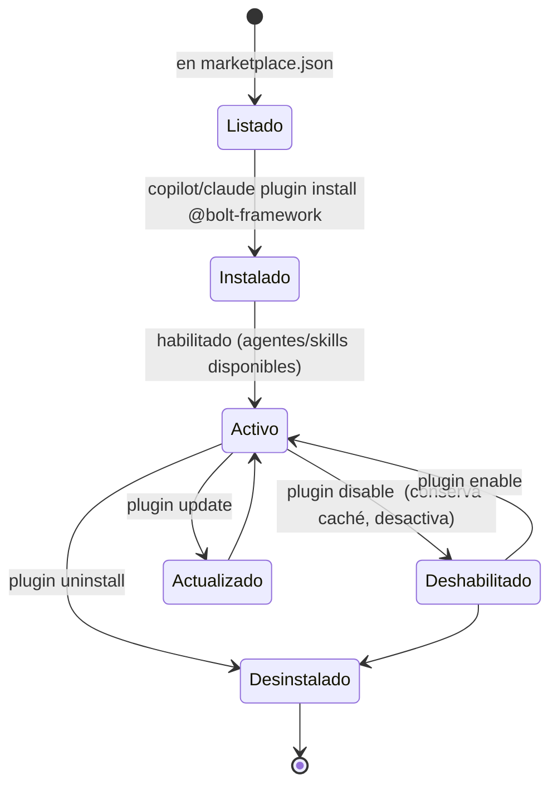
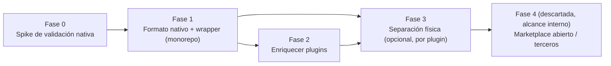

# Propuesta y plan: distribución modular de Bolt Framework mediante plugins nativos

> **Estado**: Borrador para revisión (v2 — sustituye el resolver propio) · **Fecha**: 2026-08-06 ·
> **Ámbito**: arquitectura modular y mecanismo de distribución/empaquetado del framework. ·
> **Fase 0**: ✅ completada — ver [ADR-001](adr/ADR-001-native-plugin-distribution-mechanism.md).
>
> **Objetivo**: convertir Bolt Framework en un sistema **modular** — un **plugin base (`bolt-core`)**
> siempre instalado al que se **añaden dinámicamente uno o varios plugins** por tecnología
> (_Frontend_, _Backend_, _Cloud/Infra_, _Data & AI_, _CRM_, …) — distribuidos con el **mecanismo
> nativo de plugins** que comparten GitHub Copilot CLI y Claude Code, en vez de un resolver a medida.
>
> **Actualización (2026-10-09) — Fase 3 adelantada, marketplace real**: `plugins/` ya **no** vive
> comprometido en este monorepo — el contenido real y definitivo se publica en
> `Avanade-Region-Spain/bolt-framework-marketplace` (repo privado de la organización). `bolt plugin
> config`/`add`/`update` (`Invoke-BoltPlugin.ps1` / `bolt-plugin.sh`) sincronizan bajo demanda, vía
> `git sparse-checkout` plano, solo los plugins seleccionados hacia el `plugins/<id>/` local del
> proyecto (gitignored) — **no** vía `claude plugin install`/`copilot plugin install`, para que
> funcione igual con o sin Claude Code instalado (Copilot es la gran mayoría de usuarios) y sin
> depender de la política de marketplaces permitidos de Claude Code (que bloquea tanto el origen
> GitHub como, se ha comprobado, el propio nombre de marketplace "bolt-framework" al instalar vía
> `claude plugin install`). Esto incluye al propio bolt-framework: tras clonar este repo, un
> mantenedor recupera su propio tooling `bolt-*` ejecutando `bolt plugin config` una vez — ya no
> viene pre-cargado. Ver `Invoke-BoltPlugin.ps1`'s `Sync-MarketplaceCache`/`Sync-SelectedPlugins`.

## Resumen ejecutivo

Hoy Bolt Framework se distribuye como **un único paquete monolítico**: el subtree `.boltf/` más un
sincronizador que copia **todos** los agentes y **todas** las skills a cada proyecto, sea cual sea su
tecnología. La especialización por tecnología solo existe **lógicamente y en tiempo de `init`** (el
selector de _Practice_ mapea a _scopes_); no hay ningún artefacto empaquetado, versionado ni
instalable que represente un plugin, ni forma de **añadir/quitar** capacidades tras la creación.

Esta revisión **descarta el resolver propio** (`plugin.yaml`/`registry.yaml`/`Add-BoltPlugin`, etc.
de la v1 de este documento) tras confirmar que **GitHub Copilot CLI y Claude Code ya tienen un
sistema de plugins nativo, maduro y prácticamente idéntico entre ambos** — hasta el punto de que
Copilot CLI lee directamente el formato de manifiesto de Claude Code (`.claude-plugin/plugin.json` y
`.claude-plugin/marketplace.json`). Construir un resolver propio duplicaría algo que ya existe y que
es **dual-client de fábrica**.

El modelo revisado:

- **`bolt-core`** — metodología AI-DLC, agentes transversales, skills comunes, motor de provisioning
  y constitución base. Se modela con el **mismo formato de plugin** que el resto (para que sea igual
  de fácil de actualizar/mantener), pero el wrapper `bolt plugin` lo instala **siempre** y no ofrece
  una acción para desinstalarlo.
- **Plugins por tecnología** — unidades independientes empaquetadas con el formato nativo
  (`.claude-plugin/plugin.json`), que se **añaden dinámicamente** sobre el core:
  `bolt-frontend`, `bolt-backend`, `bolt-cloud-platform` (separados **desde el primer día**, no como
  un `bolt-apps-infra` combinado); `bolt-data`, `bolt-ai` (separados también, no un `bolt-data-ai`
  combinado); `bolt-crm`; `bolt-work-management` y `bolt-integration` (se mantienen **separados por
  ahora** — fusionarlos más adelante es un cambio de bajo coste si la adopción lo justifica).
- **Asignación exclusiva** — cada skill/agente pertenece a **un único** plugin (1:1). No se persigue
  un mapeo muchos-a-muchos: si algo es realmente transversal, vive en `bolt-core`.
- **Sin agrupaciones preestablecidas** — el menú de selección de plugins no ofrece combos tipo
  "Fullstack"; cada plugin se marca de forma independiente, porque no todo proyecto necesita
  frontend+backend+cloud (p. ej. una API sola no necesita `bolt-frontend` ni `bolt-cloud-platform`).
- **Ciclo de vida** — `install`, `enable/disable`, `update`, `uninstall` **nativos** de la CLI
  (`copilot plugin …` / `claude plugin …`), envueltos por un comando propio `bolt plugin …` que además
  gestiona el estado específico de Bolt (constitución, scopes) que la CLI no conoce.
- **Distribución** — un único repositorio (monorepo) al inicio, con un **`marketplace.json`** en la
  raíz que referencia cada plugin por **ruta relativa** (`./plugins/<id>`). La migración a repos
  independientes por plugin (Fase 3) es un cambio de `source`, no de formato. El alcance del
  marketplace es **interno** (no se abre a terceros).

Se recomienda una implementación **en fases**: primero adoptar el formato nativo sobre el monorepo
actual (bajo riesgo, retrocompatible), después enriquecer el contenido de cada plugin, y solo cuando
la adopción lo justifique, separar físicamente en repos por plugin.

## Objetivo y alcance

### En alcance

- Análisis del modelo de distribución actual (_as-is_).
- Diseño de la **arquitectura modular** (`bolt-core` + plugins por tecnología) y su ciclo de vida.
- Diseño del **empaquetado y distribución nativos** (`.claude-plugin/plugin.json` +
  `.claude-plugin/marketplace.json`, dual-client Copilot CLI/Claude Code) y del wrapper `bolt plugin`.
- Matriz de asignación inicial de contenido actual a plugins (frontend/backend/cloud-platform
  separados desde el inicio).
- Plan de implementación por fases, compatibilidad hacia atrás, riesgos y métricas.

### Fuera de alcance

- Reescribir la metodología AI-DLC o los agentes existentes.
- Cambiar el contrato dual-client (Copilot + Claude).
- Implementar el código (este documento es la base de decisión previa).

## Análisis del _as-is_

### Dos capas de contenido, dos mecanismos

| Capa                                    | Ubicación                                          | ¿Cómo llega al consumidor?                | Selectivo por tecnología  |
| --------------------------------------- | -------------------------------------------------- | ----------------------------------------- | ------------------------- |
| **Payload `.boltf/`**                   | `.boltf/`                                          | `git subtree` (`--prefix=.boltf`)         | No — se distribuye entero |
| **Agentes**                             | `.github/agents/*.agent.md`, `.claude/agents/*.md` | `Update-BoltFramework.ps1` (sync directo) | No — se copian todos      |
| **Skills de metodología**               | `.claude/skills/*/SKILL.md`                        | `Update-BoltFramework.ps1` (sync directo) | No — se copian todas      |
| **Prompts / instructions**              | `.github/prompts/`, `.github/instructions/`        | Provisioning por scope                    | Parcial                   |
| **Constitución, MCP, available-skills** | `.boltf/scopes/*`, `.boltf/available-skills/*`     | Provisioning por scope (`scope.yaml`)     | Sí                        |

Inventario aproximado: **~32 agentes**, **~58 skills** de metodología, **9 scopes**
(`ai`, `backend`, `cloud-platform`, `common`, `crm`, `data`, `frontend`, `integration`,
`work-management`) y una biblioteca `available-skills/` por tecnología (`angular`, `aspire`, `azdo`,
`azure`, `bolt-framework`, `browser-testing`, `document`, `dotnet-backend`, `frontend`,
`functional-tests`, `github`, `skill-senior-devops`, `tdd`, `ui-common`, `vue`).

### Mecanismo actual



El mapeo _Practice → scopes_ (**Apps & Infra** → `backend`, `frontend`, `cloud-platform`;
**Data & AI** → `data`, `ai`, `integration`; **CRM** → `crm`; + `common` siempre) ya expresa las
familias tecnológicas objetivo, pero es una **decisión efímera de `init`**, no un módulo distribuible.

### Puntos de dolor que motivan la modularidad

| #   | Problema                                                                                   | Impacto                                                       |
| --- | ------------------------------------------------------------------------------------------ | ------------------------------------------------------------- |
| 1   | **Monolítico**: todo proyecto recibe los ~32 agentes, ~58 skills y el `.boltf/` completo.  | Ruido, `.claude/skills` inflado, mal _triggering_.            |
| 2   | **No hay plugin como artefacto** ni forma de **añadir/quitar** capacidades tras el `init`. | Imposible componer dinámicamente; sin roadmap por tecnología. |
| 3   | **Versionado acoplado**: los scopes se publican juntos.                                    | Un cambio en `crm` fuerza re-release global.                  |
| 4   | **Dos rutas de actualización** (subtree vs. script).                                       | _Drift_ y UX de update confusa.                               |
| 5   | **Sin registro ni descubrimiento** de qué plugins existen ni de sus versiones.             | No hay _marketplace_ ni telemetría de adopción.               |

## Modelo objetivo: arquitectura de plugins nativos

### `bolt-core` + plugins por tecnología



**Reglas de composición**

- `bolt-core` es un plugin más a efectos de formato, pero **el wrapper `bolt plugin` lo instala
  siempre** y no ofrece una acción directa de desinstalarlo.
- **`bolt-frontend`, `bolt-backend` y `bolt-cloud-platform` son plugins independientes desde el primer
  día** (no existe un `bolt-apps-infra` combinado) — reflejan una separación que ya existe hoy como
  _scopes_ (`frontend`, `backend`, `cloud-platform`) con contenido casi disjunto.
- **`bolt-data` y `bolt-ai` también se separan desde el primer día** (no existe un `bolt-data-ai`
  combinado) — no tiene sentido mantenerlos juntos.
- **`bolt-work-management` y `bolt-integration` se mantienen como dos plugins independientes por
  ahora** (no se fusionan). Es una decisión revisable: fusionarlos más adelante es un cambio de bajo
  coste si la duplicación de contenido entre ambos genera fricción real.
- **Asignación exclusiva (1:1)**: cada skill/agente/available-skill pertenece a un único plugin. Si
  un contenido es realmente transversal a cualquier tecnología, se asigna a `bolt-core`, no se
  duplica ni se comparte entre plugins.
- **Sin agrupaciones/presets**: el menú de selección no ofrece combos preseleccionados (p. ej.
  "Fullstack"). Cada plugin se marca individualmente porque no todo proyecto necesita todas las
  tecnologías (p. ej. una API sin frontend ni cloud-platform).
- Los plugins son **aditivos** — un proyecto puede tener 0, 1 o varios instalados simultáneamente.
- No hay dependencias entre plugins de tecnología (todos dependen solo de `bolt-core`, de forma
  implícita, al requerir su motor de provisioning y constitución base).

### Anatomía de un plugin (formato nativo `.claude-plugin/`)

Cada plugin usa el formato que **ya comparten** GitHub Copilot CLI y Claude Code — un único manifiesto
sirve a los dos clientes, sin duplicar nada:

```text
plugins/bolt-frontend/
├── .claude-plugin/
│   └── plugin.json        # nombre, versión, rutas a agents/skills/commands/mcpServers
├── agents/                # agentes específicos del plugin (opcional)
├── skills/                # skills de metodología específicas del plugin
├── commands/               # slash-commands específicos (opcional)
└── mcpServers/             # presets MCP del plugin (opcional)
```

```json
// plugins/bolt-frontend/.claude-plugin/plugin.json
{
  "name": "bolt-frontend",
  "description": "Skills, agentes y presets MCP para frontend (Angular/React/Vue, UI/UX, Penpot).",
  "version": "0.1.0",
  "author": { "name": "Bolt Framework" },
  "skills": ["skills"],
  "agents": ["agents"],
  "mcpServers": ["mcpServers"]
}
```

### El marketplace del monorepo (`.claude-plugin/marketplace.json`)

Al inicio, un único `marketplace.json` en la raíz del repo referencia cada plugin por **ruta
relativa**, sin necesidad de repos separados:

```json
// .claude-plugin/marketplace.json
{
  "name": "bolt-framework",
  "owner": { "name": "Bolt Framework" },
  "plugins": [
    { "name": "bolt-core", "source": "./plugins/bolt-core", "defaultEnabled": true },
    { "name": "bolt-frontend", "source": "./plugins/bolt-frontend" },
    { "name": "bolt-backend", "source": "./plugins/bolt-backend" },
    { "name": "bolt-cloud-platform", "source": "./plugins/bolt-cloud-platform" },
    { "name": "bolt-data", "source": "./plugins/bolt-data" },
    { "name": "bolt-ai", "source": "./plugins/bolt-ai" },
    { "name": "bolt-crm", "source": "./plugins/bolt-crm" },
    { "name": "bolt-work-management", "source": "./plugins/bolt-work-management" },
    { "name": "bolt-integration", "source": "./plugins/bolt-integration" }
  ]
}
```

Migrar un plugin a su propio repositorio más adelante (Fase 3) solo cambia su entrada `source` (de
ruta relativa a `{ "source": "github", "repo": "…" }` o `git-subdir`) — el resto del `marketplace.json`
no se toca.

## Matriz de asignación inicial de plugins

Propuesta concreta de reparto del contenido **actual** (sustituye el "Anexo A — a completar" de la v1).
Se basa 1:1 en los _scopes_ ya existentes en `.boltf/scopes/`, separando explícitamente `frontend`,
`backend` y `cloud-platform`.

| Plugin                     | Origen (_scopes_ actuales) | Contenido representativo (real, hoy)                                                                                                                                                                                                                                                                                                                                                                                                                                                                 |
| -------------------------- | -------------------------- | ---------------------------------------------------------------------------------------------------------------------------------------------------------------------------------------------------------------------------------------------------------------------------------------------------------------------------------------------------------------------------------------------------------------------------------------------------------------------------------------------------- |
| **`bolt-core`**            | `common` + metodología     | Los ~32 agentes y ~58 skills `bolt-*`/`skill-bolt-*` (ADR, DDD, plan, tasks, testing, review, security, researcher, …), skills universales de `common` (`markdown-formatting`, `tdd-comprehensive`, `gherkin-reqnroll`, `git-branch-manager`, `issue-formatter`, `mermaid-creator`, `planning-with-files`, `api-contracts-doc`, `architect-diagramer`, `user-journey-doc`, `integration-e2e-testing`, `playwright-e2e`), motor de provisioning (`skill-bolt-setup-constitution`), constitución base. |
| **`bolt-frontend`**        | `frontend`                 | Agentes `bolt-ux-design`, `bolt-mockup`, `bolt-penpot` (se mueven desde el core); skills `tailwind-design-system`, `interface-design`, `web-design-reviewer` (metodología); available-skills `frontend-design`, `senior-frontend`, `angular/`, `vue/`, `frontend/`, subconjunto de `ui-common/`; instructions React/Angular/Vue; config de exportación de tokens Penpot.                                                                                                                             |
| **`bolt-backend`**         | `backend`                  | `skill-architecture-patterns`, `skill-cqrs-event-sourcing`, `skill-database-selection`, `skill-identity-provider-selection`; available-skills `dotnet-backend/`; instructions .NET/C# (`dotnet-architecture-good-practices`, `csharp`); skill `trailofbits-static-analysis`.                                                                                                                                                                                                                         |
| **`bolt-cloud-platform`**  | `cloud-platform`           | `skill-aspire-orchestration`, `skill-container-orchestration`, `skill-iac-tool-selection`, `skill-landing-zone-architecture`, `skill-senior-devops`; available-skills `azure/`; instructions/prompts Bicep, Kubernetes, Terraform, pipelines de Azure DevOps.                                                                                                                                                                                                                                        |
| **`bolt-data`**            | `data`                     | Prompts/instructions SQL Server/PostgreSQL (`sql-optimization`, `postgresql-optimization`, `ms-sql-dba`), skill `csv-data-summarizer`.                                                                                                                                                                                                                                                                                                                                                               |
| **`bolt-ai`**              | `ai`                       | `task-implementation`, `ai-prompt-safety-review`, prompt OpenTelemetry .NET, skill `scientific-skills`.                                                                                                                                                                                                                                                                                                                                                                                              |
| **`bolt-crm`**             | `crm`                      | Instructions/prompts Power Apps Code Apps y Power Platform MCP; skill `internal-comms`.                                                                                                                                                                                                                                                                                                                                                                                                              |
| **`bolt-work-management`** | `work-management`          | Skills `skill-cicd-pipeline-azure`, `github-actions-templates`, `skill-azdo-pipeline-templates`, `azdo-sync`; prompts Azure Boards / GitHub Projects / pipelines multi-stage.                                                                                                                                                                                                                                                                                                                        |
| **`bolt-integration`**     | `integration`              | Skills `azdo-wiki`; prompt `azure-devops-pipelines`; instructions `spec-driven-workflow-v1`, `planning-with-files`. (`azdo-sync` ya NO se activa aquí — ver nota de resolución abajo.)                                                                                                                                                                                                                                                                                                               |

**Contenido compartido hoy entre dos _scopes_** (a resolver con asignación exclusiva, sin duplicar
salvo que ya se duplique en el modelo actual):

- `available-skills/aspire/skill-aspire-opentelemetry-frontend` — hoy referenciado tanto por
  `frontend` como por `backend`. Propuesta: propietario `bolt-backend` (Aspire AppHost es un concepto
  de orquestación backend); `bolt-frontend` puede seguir incluyendo su propia copia si se considera
  necesaria (ya se materializa como dos ficheros distintos hoy, no es un requisito nuevo).
- `azdo-sync` — **RESUELTO (2026-08-11)**: la duplicación entre `integration` y `work-management`
  causó fricción real (colisión de skill con el mismo `name: azdo-sync` cargado simultáneamente desde
  dos plugins activos → `Failed to load 1 skill` en Copilot). Owner único ahora:
  `bolt-work-management`. El item `integration-azure-devops-sync-skill` se retiró de
  `scopes/integration/scope.yaml`; `bolt-integration` conserva solo `azdo-wiki`. Proyectos que
  necesiten ambos deben activar los dos scopes (`integration` + `work-management`).
- `planning-with-files` — ya vive en `common` (`bolt-core`); las referencias adicionales en
  `integration`/`work-management` son redundantes y se pueden retirar al migrar a plugins,
  independientemente de si ambos acaban fusionándose o no.

## Ciclo de vida de un plugin (comandos nativos)



El `install`/`uninstall`/`enable`/`disable`/`update` **ya los da la CLI nativa** (`copilot plugin …` y
`claude plugin …`); Bolt no reimplementa esta mecánica, solo la envuelve (ver siguiente sección).

## El comando `bolt plugin` — wrapper sobre la CLI nativa

En vez de un resolver propio, `bolt plugin` es una **capa fina** que:

1. Muestra un **menú de selección** (checklist) con los plugins disponibles en `marketplace.json`.
2. Por cada plugin marcado, invoca la CLI nativa correspondiente — **de forma asimétrica**, porque
   solo Claude Code tiene un concepto de alcance por proyecto (ver
   [Alcance por proyecto (scope) y `Start-BoltCopilot`](#alcance-por-proyecto-scope-y-start-boltcopilot)):
   - `claude plugin marketplace add ./ --scope project` + `claude plugin install <id>@bolt-framework --scope project`
   - Copilot CLI: **no se invoca `copilot plugin install/uninstall`** para plugins de
     `bolt-framework` — `bolt plugin config` solo actualiza `plugins-state.yaml`, y es
     `Start-BoltCopilot.ps1`/`start-bolt-copilot.sh` quien monta cada plugin seleccionado con
     `copilot --plugin-dir <ruta>` en cada arranque.
3. Persiste el **estado propio de Bolt** que la CLI nativa no conoce (decisiones de constitución,
   `scopes.yaml`, presets MCP elegidos) en un fichero ligero, p. ej.
   `.boltf/memory/plugins-state.yaml` — ya **no** es un inventario de ficheros instalados (eso lo
   gestiona la CLI para Claude), solo decisiones de negocio de Bolt. Para Copilot,
   `plugins-state.yaml` **es** la fuente de verdad de qué montar (no hay estado nativo que consultar).
4. Continúa con el flujo existente de `skill-bolt-setup-constitution` para rellenar la constitución
   según los plugins/scopes elegidos.

```powershell
# Descubrir
bolt plugin list                     # claude: `claude plugin list`; copilot: lee plugins-state.yaml

# Seleccionar interactivamente (nuevo — antes del init)
bolt plugin config                   # menú checklist -> claude instala (--scope project); copilot solo guarda plugins-state.yaml

# Añadir/quitar uno concreto sin pasar por el menú
bolt plugin add bolt-data
bolt plugin remove bolt-crm

# Gestionar
bolt plugin status                   # plugins-state.yaml + estado nativo de Claude
bolt plugin update --all             # claude: `claude plugin update --all --scope project`; copilot: no-op (no cachea nada)

# Lanzar Copilot con los plugins seleccionados montados (--plugin-dir)
.boltf/scripts/powershell/Start-BoltCopilot.ps1              # Windows
.boltf/scripts/bash/start-bolt-copilot.sh                     # Linux/macOS/WSL
```

> `bolt plugin config`/`install` es el comando que se ejecuta **antes** de `Init.ps1`/`init.sh` (ver
> más abajo) para decidir qué tecnologías se cargan.

### Por qué no un resolver propio

| Criterio                           | Resolver propio (v1 de este documento)   | Mecanismo nativo (Copilot CLI + Claude Code)         |
| ---------------------------------- | ---------------------------------------- | ---------------------------------------------------- |
| Dual-client (Copilot + Claude)     | 🟡 dos implementaciones a mantener       | 🟢 mismo `.claude-plugin/` sirve a ambos             |
| Añadir/quitar dinámico             | 🟢 a construir                           | 🟢 ya existe (`install`/`uninstall`/`enable`)        |
| Descubrimiento / marketplace       | 🟡 registro propio a construir           | 🟢 `marketplace add/list/browse` ya existen          |
| Coste de implementación            | 🔴 alto (resolver, integridad, lockfile) | 🟢 bajo (wrapper + empaquetado)                      |
| Mantenimiento a largo plazo        | 🔴 código propio a mantener              | 🟢 lo mantienen GitHub/Anthropic                     |
| Riesgo de precedencia con proyecto | 🟡 lo decide Bolt                        | 🟡 la CLI decide (proyecto siempre gana)             |
| Necesita capa propia igualmente    | —                                        | 🟡 sí, para constitución/scopes (no lo cubre la CLI) |

**Conclusión**: se adopta el **mecanismo nativo** como capa física de distribución, y se limita el
código propio de Bolt a lo que la CLI no resuelve — selección de scopes, relleno de constitución y
bookkeeping específico de Bolt.

### Alcance por proyecto (scope) y `Start-BoltCopilot`

Investigando ambas CLIs para que la instalación quede **acotada al proyecto** (no al perfil global
del usuario) se confirmaron dos asimetrías relevantes:

- **Claude Code CLI** sí tiene un concepto de alcance: `claude plugin install|uninstall|update
[options] <plugin> -s, --scope <scope>` acepta `user` (por defecto), `project`, `local` o
  `managed`; `claude plugin marketplace add [options] <source> --scope <scope>` igual. `bolt plugin`
  adopta **`--scope project`** de forma universal en las cuatro llamadas (`marketplace add`,
  `install`, `uninstall`, `update`) — así el registro queda en el `.claude/settings.json` **del
  proyecto**, no en el perfil global del usuario, y `claude plugin list --json` permite filtrar por
  `scope: "project"` para saber qué está realmente instalado _para este proyecto_ (campo `installPath`
  incluido).
- **GitHub Copilot CLI** no tiene ningún flag de alcance en `plugin install`/`uninstall`/`marketplace
add` — el único mecanismo de montaje de plugins es el flag **global y no persistente**
  `--plugin-dir <directorio>` (repetible), que se pasa en cada invocación de `copilot`. No existe
  variable de entorno ni ajuste en `copilot help config` que lo persista.

Como consecuencia, `bolt plugin` **deja de invocar `copilot plugin install/uninstall/update`** para
plugins de `bolt-framework` — no hay nada que instalar de forma persistente para Copilot. En su
lugar:

- `bolt plugin config/add/remove/update` solo actualiza `.boltf/memory/plugins-state.yaml` para el
  cliente `copilot` (con un mensaje informativo, sin tocar la CLI nativa).
- Un nuevo launcher — `.boltf/scripts/powershell/Start-BoltCopilot.ps1` /
  `.boltf/scripts/bash/start-bolt-copilot.sh` — sustituye a invocar `copilot` directamente. En cada
  arranque, lee `plugins-state.yaml` y resuelve cada id a un directorio con esta cadena de fallback:
  1. `plugins/<id>/` local (layout actual del monorepo, Fase 1/2, o un plugin vendorizado).
  2. Si no existe localmente, consulta `claude plugin list --json`, filtra por
     `scope == "project"` e `id == "<id>@bolt-framework"`, y reutiliza su `installPath` — Claude ya
     resolvió el `source` del `marketplace.json` (ruta local o repo remoto), así que este fallback
     funciona igual **aunque el plugin ya se haya separado a su propio repo (Fase 3)** y no exista
     `plugins/<id>/` en el proyecto consumidor.
  3. Si ninguno resuelve, se avisa por consola (id no montado) y se continúa con el resto — no es un
     error fatal, para no bloquear el arranque de `copilot` por un solo plugin sin resolver.

Esta cadena de fallback es la razón por la que el diseño es **compatible hacia delante con Fase 3**
sin cambios: cuando un plugin se separa a `bolt-plugin-<id>`, únicamente cambia cómo se resuelve el
paso 2 (Claude lo descarga de un repo en vez de resolver una ruta local) — el launcher de Copilot no
se entera de la diferencia, porque solo consume el `installPath` ya resuelto por Claude.

### Sincronización de contenido vendorizado (`awesome-copilot`)

`bolt-data`, `bolt-ai` y `bolt-crm` incorporan contenido originario de `awesome-copilot` (decisión #6,
ver tabla anterior): se **vendoriza** una selección curada dentro de `plugins/<id>/`, igual que el
resto de contenido migrado en Fase 1 — no se declara como dependencia instalable de otro plugin (ver
alternativa descartada al final de esta sección).

#### Modo mantenedor vs. modo consumidor

`bolt plugin` distingue el contexto de ejecución:

- **Modo mantenedor** (dentro de este monorepo, detectado por la presencia de
  `.claude-plugin/marketplace.json` en la raíz): además del menú de selección, ofrece refrescar el
  contenido vendorizado de `awesome-copilot` contra su origen.
- **Modo consumidor** (un proyecto que instala Bolt Framework): `bolt plugin update` se limita a
  traer la versión ya publicada del plugin — **no** vuelve a descargar de `awesome-copilot` por su
  cuenta. La curación es responsabilidad del mantenedor, una única vez por release del plugin, no
  repetida en cada máquina consumidora.

#### Flujo (una sola confirmación)

1. `bolt plugin config` muestra el checklist habitual de plugins (instalados/no instalados).
2. En modo mantenedor, por cada plugin seleccionado con fuentes declaradas en
   `plugins/<id>/.vendor-sources.yaml` (repo + ruta + `sha` fijado), descarga el contenido actual de
   origen y calcula el diff contra la copia vendorizada.
3. Antes de aplicar nada, se muestra **una única pantalla de confirmación** combinada:
   - Plugins a instalar/mantener/eliminar (según el checklist).
   - Ficheros vendorizados con cambios detectados (`sha` origen → destino).
   - El **patch bump** de `version` que se aplicaría a cada `plugin.json` afectado (solo si hay
     cambios; ver más abajo por qué es obligatorio).
4. Al confirmar: aplica los ficheros, sube la versión del/de los plugin(s) afectados, ejecuta
   `copilot/claude plugin install/update/uninstall` según corresponda, y persiste
   `plugins-state.yaml`.

Flags para uso no interactivo/CI: `-SkipVendorSync` (omite el refresco en modo mantenedor) y `-Yes`
(auto-confirma), pensados para `Test-InitFlows.ps1`.

#### Por qué el bump de versión es obligatorio (y por qué NO implica un release de Bolt Framework)

- Claude Code CLI **no refresca contenido cacheado sin un cambio de `version` semver** en el
  `plugin.json` del plugin afectado (hallazgo validado en el spike de Fase 0, ver
  [ADR-001](adr/ADR-001-native-plugin-distribution-mechanism.md)). Por eso el refresco de contenido
  vendorizado siempre va acompañado de un patch bump — sin él, un consumidor que ya tuviera el
  plugin instalado no vería el cambio ni tras un `update`.
- **Este bump es de grano fino y no dispara un release del framework**: es un cambio de versión
  **del plugin afectado únicamente** (p. ej. `bolt-data` 0.1.0 → 0.1.1), commiteado como un cambio
  normal — no requiere el proceso de release completo (`bolt-release`, SemVer del framework,
  changelog, tag, GitHub Release). Ese proceso sigue existiendo por separado, a su propio ritmo, y
  simplemente incorporará los bumps de plugin acumulados desde la última release cuando se dispare.
- **El refresco es explícito y bajo demanda**: ejecutar `bolt plugin config` en modo mantenedor no
  ocurre automáticamente (sin cron, sin trigger en cada instalación de un consumidor) — es una
  acción que un mantenedor decide lanzar cuando quiere traer contenido actualizado de
  `awesome-copilot`, revisando el diff antes de aceptar.

#### Alternativa descartada

- **Dependencia declarativa entre plugins** (instalar `awesome-copilot@awesome-copilot` como
  dependencia transitiva de `bolt-data`/`bolt-ai`/`bolt-crm`): descartada — ni Copilot CLI ni Claude
  Code soportan un campo `dependencies`/`requires` en `plugin.json` (validado en el spike de
  Fase 0), instalaría el marketplace completo (no una selección curada), y rompería la métrica de
  reproducibilidad (mismo `marketplace.json` + `plugins-state.yaml` → mismo resultado).

## Plan de implementación

### Fase 0 — Spike de validación nativa (1 iteración) — ✅ Completada

- **Spike ejecutado** (Windows; ver [ADR-001](adr/ADR-001-native-plugin-distribution-mechanism.md)
  para la tabla completa de resultados): se validó en un sandbox aislado que ambos CLIs aceptan un
  directorio local (sin `.git`) como `source` de marketplace vía `.claude-plugin/marketplace.json`
  con ruta relativa. Se confirmó paridad en el flujo principal (`marketplace add` → `install` →
  `list` → `uninstall`), con **dos divergencias documentadas** que se adoptan como restricciones de
  autoría/proceso:
  1. `plugin.json` debe declarar `skills`/`agents`/etc. con rutas `./`-relativas (ej. `"./skills"`);
     Claude Code rechaza nombres de directorio sin prefijo, Copilot CLI acepta ambos formatos.
  2. El proceso de release de Bolt **debe** incrementar el `version` semver en cada cambio de
     contenido — Claude Code CLI no refresca el contenido cacheado en `plugin update` si la versión
     no cambia (Copilot CLI sí lo hace siempre).
  - Validación Linux/WSL **no realizada** en este spike (sin entorno disponible) — pendiente como
    seguimiento antes de dar por cerrada la paridad multiplataforma completa.
- **Matriz de asignación**: confirmada como parte de este ciclo de revisión (sin objeciones
  pendientes de los propietarios de _scope_ tras el proceso de reescritura del documento).
- **Entregables**: [ADR-001](adr/ADR-001-native-plugin-distribution-mechanism.md) (cambio de
  resolver propio a mecanismo nativo, con resultados completos del spike), matriz de asignación
  validada (sección anterior), resultado del spike de instalación local (arriba y en el ADR).

### Fase 1 — Adoptar el formato nativo sobre el monorepo (retrocompatible) (2-3 iteraciones)

- Reestructurar `.boltf/` a `plugins/<id>/` (`bolt-core`, `bolt-frontend`, `bolt-backend`,
  `bolt-cloud-platform`, `bolt-data`, `bolt-ai`, `bolt-crm`, `bolt-work-management`,
  `bolt-integration`), cada uno con su `.claude-plugin/plugin.json`.
- Publicar `.claude-plugin/marketplace.json` en la raíz del repo con `source` relativo a cada plugin.
- Implementar el wrapper **`bolt plugin`** (`config`/`add`/`remove`/`status`/`update`, PowerShell +
  bash) que delega en `copilot plugin …` / `claude plugin …` y persiste
  `.boltf/memory/plugins-state.yaml` (decisiones propias de Bolt, no inventario de ficheros); incluye
  el modo mantenedor de sincronización de contenido vendorizado (ver
  [Sincronización de contenido vendorizado](#sincronización-de-contenido-vendorizado-awesome-copilot)),
  aunque su primer uso real de curación llega en Fase 2.
- Hacer que `skill-bolt-setup-constitution` lea `plugins-state.yaml` para saber qué constitución de
  scope rellenar (sustituye la lectura directa de `scopes.yaml` como única fuente).
- `Init.ps1`/`init.sh`: añadir el paso `bolt plugin config` **antes** del flujo de constitución
  (ver sección siguiente).
- **VS Code (Copilot Chat) no auto-descubre `plugins/<id>/{agents,skills}`** — solo
  `.github/agents/*.agent.md` de forma nativa. `Init.ps1`/`init.sh` (función
  `Set-VSCodeAgentDiscovery` / `set_vscode_agent_discovery`) regeneran
  `.vscode/settings.json` con las claves `chat.agentFilesLocations` /
  `chat.agentSkillsLocations` (una entrada por carpeta `agents`/`skills` que exista en disco
  para cada plugin instalado), fusionando sin pisar el resto de settings existentes (o
  saltando con warning si el JSON existente no se puede parsear, para no arriesgar un fichero
  editado a mano). El wrapper **`bolt plugin`** (`config`/`add`/`remove`) invoca la misma
  función tras cada cambio de estado, así que el fichero se mantiene sincronizado en todo el
  ciclo de vida (no solo en el scaffold inicial).
- **Entregables**: `plugins/*` con manifiestos nativos, `marketplace.json`, wrapper funcional
  (incluye regeneración de `.vscode/settings.json` en `config`/`add`/`remove`), provisioning
  actualizado, docs de uso, `Test-InitFlows` extendido con el nuevo paso y con el Test 9
  (`Test-09-VSCodeAgentDiscovery`) cubriendo scaffold inicial, refresh add/remove y manejo de
  JSON malformado.

### Fase 2 — Enriquecer contenido por plugin (2-3 iteraciones, en paralelo)

- **`bolt-data`**, **`bolt-ai`** y **`bolt-crm`**: crear/portar agentes, skills y presets MCP propios
  (hoy casi inexistentes o solo referencias `awesome_copilot`), hasta paridad de calidad con
  `bolt-core`. Curación inicial vía `plugins/<id>/.vendor-sources.yaml` + `bolt plugin config` en
  modo mantenedor (ver [Sincronización de contenido vendorizado](#sincronización-de-contenido-vendorizado-awesome-copilot)).
- **`bolt-frontend`**, **`bolt-backend`**, **`bolt-cloud-platform`**: consolidar y depurar duplicados
  señalados en la matriz de asignación (p. ej. `skill-aspire-opentelemetry-frontend`).
- **`bolt-work-management`/`bolt-integration`**: se mantienen separados (decisión tomada); la
  duplicación de `azdo-sync` ya generó fricción real y se resolvió asignando `bolt-work-management`
  como owner único (ver matriz de asignación arriba).
- **Entregables**: catálogo de contenidos por plugin sin duplicados no justificados.

### Fase 3 — Separación física opcional (repos por plugin) (2-3 iteraciones, bajo demanda)

- Extraer el/los plugin(s) que lo justifiquen por adopción o cadencia de release propia a su repo
  `bolt-plugin-<id>`, cambiando su entrada en `marketplace.json` de ruta relativa a
  `{ "source": "github", "repo": "…" }` (o `git-subdir` si se prefiere mantener el historial en el
  monorepo mientras se sirve como sparse-checkout).
- El resto de plugins **permanece en el monorepo** — la separación es plugin a plugin, no un
  "big bang".
- **Entregables**: repo(s) por plugin extraído, `marketplace.json` actualizado, guía de publicación.

### Fase 4 (descartada por ahora — alcance interno) — Marketplace abierto y plugins de terceros

> **Decisión**: el alcance de este marketplace es **interno**. Esta fase queda documentada solo como
> referencia futura por si el alcance cambiara más adelante; no forma parte del plan actual.

- Publicar `bolt-framework` como marketplace consumible por `copilot plugin marketplace add` /
  `claude plugin marketplace add` fuera de la organización, si en el futuro se decide abrir el alcance.
- Adoptar controles de nivel empresa si aplica (`strictKnownMarketplaces`, `extraKnownMarketplaces`,
  `enabledPlugins` declarativos en `.github/copilot/settings.json`/`.claude/settings.json`).
- **Entregables**: guía pública "cómo crear un plugin Bolt", política de terceros.



## Cambios en `Init.ps1` / `init.sh`

El flujo de inicialización incorpora un paso nuevo, **antes** de la constitución:

1. **`bolt plugin config`** (nuevo) — menú checklist de plugins (`bolt-frontend`, `bolt-backend`,
   `bolt-cloud-platform`, `bolt-data`, `bolt-ai`, `bolt-crm`, `bolt-work-management`,
   `bolt-integration`), **sin agrupaciones/presets preseleccionados** — cada plugin se marca de forma
   independiente; `bolt-core` se instala siempre sin preguntar. Internamente instala vía
   `copilot plugin install …@bolt-framework` y/o `claude plugin install …@bolt-framework` y escribe
   `.boltf/memory/plugins-state.yaml`.
2. **Flujo actual** (`skill-bolt-setup-constitution`) — sigue rellenando la constitución y generando
   `scopes.yaml`, ahora informado por los plugins elegidos en el paso 1 en vez de solo por la
   _Practice_ seleccionada.
3. **Implicación a decidir**: si los agentes/skills de cada plugin los entrega ya la CLI nativa,
   `Update-BoltFramework.ps1` debería **dejar de copiar directamente** los agentes/skills que ahora
   vive en plugins de tecnología (sí seguiría sincronizando `bolt-core`, o incluso `bolt-core` pasa a
   instalarse también como plugin). Esto es necesario porque los artefactos a nivel de proyecto
   **siempre tienen prioridad** sobre los del plugin en ambas CLIs — si se siguen copiando a mano,
   el plugin nunca "gana" ni se puede desactivar realmente.

## Compatibilidad hacia atrás y migración

- **Consumidores existentes** siguen funcionando. En la primera actualización tras la Fase 1, si no
  existe `.boltf/memory/plugins-state.yaml`, se **infiere el conjunto de plugins desde `scopes.yaml`**
  y se instalan vía la CLI nativa automáticamente (migrador `Migrate-ToPlugins`).
- **Destinos sin cambios**: los artefactos siguen materializándose en `.github/`, `.claude/`, `memory/`,
  `.vscode/`. Cambia el **mecanismo de entrega** (plugin nativo en vez de sync directo), no las rutas.
- **Sin cambio de esquema de `scope.yaml`** en Fase 1: el contenido de cada _scope_ pasa a vivir bajo
  `plugins/<id>/`, pero su estructura interna (`items[]`, `source`, `destination`) no cambia.

## Riesgos y mitigaciones

| Riesgo                                                                 | Prob. | Impacto | Mitigación                                                                                            |
| ---------------------------------------------------------------------- | ----- | ------- | ----------------------------------------------------------------------------------------------------- |
| Reestructurar `.boltf/` a `plugins/<id>/` rompe rutas relativas        | Media | Alto    | _Shims_ + `Validate-Scopes` + `Test-InitFlows` previos a publicar                                     |
| Artefactos de proyecto ya sincronizados "tapan" los del plugin         | Alta  | Alto    | `Update-BoltFramework.ps1` deja de copiar directamente lo que pasa a plugin (ver sección anterior)    |
| Diferencias de comportamiento entre `copilot plugin` y `claude plugin` | Media | Medio   | Validación empírica en Fase 0; wrapper `bolt plugin` normaliza la UX aunque la CLI subyacente difiera |
| Plugins `bolt-data`/`bolt-ai`/`bolt-crm` "vacíos" defraudan            | Alta  | Medio   | Fase 2 como enriquecimiento; contenido mínimo viable por plugin                                       |
| Contenido hoy compartido entre dos _scopes_ queda mal asignado         | Media | Bajo    | Matriz de asignación explícita (ver sección anterior) resuelve los casos conocidos                    |
| Cambios de la CLI nativa (GitHub/Anthropic) afectan al wrapper         | Baja  | Medio   | Wrapper fino y testeado; sin lógica de negocio duplicada que diverja de la CLI                        |

## Métricas de éxito

- **Composición dinámica**: añadir/quitar un plugin sin re-init, en un comando (`bolt plugin add/remove`).
- **Reducción de artefactos irrelevantes** en un proyecto CRM (solo `bolt-core` + `bolt-crm`).
- **Un único manifiesto por plugin** consumible por Copilot CLI y Claude Code sin duplicación.
- **Releases independientes**: publicar un plugin extraído a su propio repo sin re-release del resto.
- **Cero regresiones** en `Test-InitFlows` y provisioning tras la migración.
- **Reproducibilidad**: mismo `marketplace.json` + `plugins-state.yaml` → mismo resultado entre máquinas.

## Decisiones y preguntas abiertas

### Decisiones tomadas

| #   | Pregunta                                                                        | Decisión                                                                                                                                                                                                                                                                                                                            |
| --- | ------------------------------------------------------------------------------- | ----------------------------------------------------------------------------------------------------------------------------------------------------------------------------------------------------------------------------------------------------------------------------------------------------------------------------------- |
| 1   | `integration` + `work-management`: ¿fusionar o mantener separados?              | **Se mantienen separados** por ahora (`bolt-work-management`, `bolt-integration`). Fusionar es un cambio de bajo coste si la adopción lo justifica más adelante.                                                                                                                                                                    |
| 2   | `bolt-data-ai`: ¿combinado o separado?                                          | **Se separan** en `bolt-data` y `bolt-ai` — no tiene sentido mantenerlos juntos.                                                                                                                                                                                                                                                    |
| 3   | Alcance de terceros: ¿interno o abierto?                                        | **Interno.** La Fase 4 (marketplace abierto) queda descartada por ahora (ver sección de Fase 4).                                                                                                                                                                                                                                    |
| 4   | `bolt-core`: ¿plugin real o capa especial?                                      | **Se configura como plugin** (mismo formato `.claude-plugin/`) para que sea fácil de actualizar y mantener, pero el wrapper `bolt plugin` lo instala **siempre** (100% de las veces), sin desinstalación.                                                                                                                           |
| 5   | Presets/agrupaciones en el menú (p. ej. "Fullstack")                            | **No se ofrecen agrupaciones.** Cada plugin se marca de forma independiente — no todo proyecto necesita todas las tecnologías (p. ej. una API sin frontend ni cloud-platform).                                                                                                                                                      |
| 6   | `awesome-copilot`: ¿dependencia declarativa entre plugins o vendorizado propio? | **Se vendoriza** (Opción C) dentro de `plugins/bolt-data`, `bolt-ai` y `bolt-crm`, curado y con refresco explícito en modo mantenedor — ver [Sincronización de contenido vendorizado](#sincronización-de-contenido-vendorizado-awesome-copilot). Se descarta declarar `awesome-copilot` como dependencia instalable de otro plugin. |

### Resuelto (spike Fase 0)

1. **Paridad Copilot CLI vs. Claude Code**: ✅ validado empíricamente en Windows (ver
   [ADR-001](adr/ADR-001-native-plugin-distribution-mechanism.md)). El flujo principal
   (`marketplace add` con ruta local relativa → `install` → `list` → `uninstall`) es paritario en
   ambas CLIs. Se identificaron y documentaron dos divergencias que se adoptan como restricciones de
   autoría/proceso para Fase 1: formato `./`-relativo obligatorio en los arrays de `plugin.json`
   (`skills`, `agents`, …), y disciplina de incremento de `version` semver en cada release (Claude
   Code no refresca contenido cacheado sin cambio de versión). **Pendiente de seguimiento**:
   validación en Linux/WSL (no se dispuso de entorno en este spike).

## Anexos

### Anexo A — Matriz de asignación

Ver [Matriz de asignación inicial de plugins](#matriz-de-asignación-inicial-de-plugins) más arriba —
sustituye la matriz "a completar" de la v1 de este documento con una propuesta concreta basada en el
contenido real de `.boltf/scopes/` y `.boltf/available-skills/`.

### Anexo B — Referencias en el repositorio

- Manifiesto y versionado: `.boltf/bolt-manifest.yaml`
- Scopes y plantilla: `.boltf/scopes/`, `.boltf/scopes/scope-template.yaml`, `.boltf/scopes/README.md`
- Biblioteca de skills: `.boltf/available-skills/README.md`
- Wrapper `bolt plugin`: `.boltf/scripts/powershell/Invoke-BoltPlugin.ps1`, `.boltf/scripts/bash/bolt-plugin.sh`
- Launcher de Copilot (`--plugin-dir`, sin instalación nativa): `.boltf/scripts/powershell/Start-BoltCopilot.ps1`,
  `.boltf/scripts/bash/start-bolt-copilot.sh`
- Distribución (subtree, a sustituir gradualmente): `.boltf/scripts/powershell/BoltFramework.psm1`
- Actualización de agentes/skills (a acotar a `bolt-core`): `.boltf/scripts/powershell/Update-BoltFramework.ps1`
- Provisioning (Step 2): `.claude/skills/skill-bolt-setup-constitution/`,
  `.boltf/scripts/powershell/Invoke-BoltSetupConstitution.ps1`
- Inicialización: `Init.ps1`, `init.sh`
- ADR: [ADR-001 — Adopt the Native Copilot CLI / Claude Code Plugin Mechanism for Bolt Framework
  Distribution](adr/ADR-001-native-plugin-distribution-mechanism.md) — decisión formal y resultados
  completos del spike de Fase 0.

### Anexo C — Referencias externas

- Documentación oficial del mecanismo nativo:
  - GitHub Copilot CLI — [CLI plugin reference](https://docs.github.com/en/copilot/reference/copilot-cli-reference/cli-plugin-reference),
    [About plugins](https://docs.github.com/en/copilot/concepts/agents/about-plugins)
  - Claude Code — [Plugins](https://code.claude.com/docs/en/plugins),
    [Plugin marketplaces](https://code.claude.com/docs/en/plugin-marketplaces)
