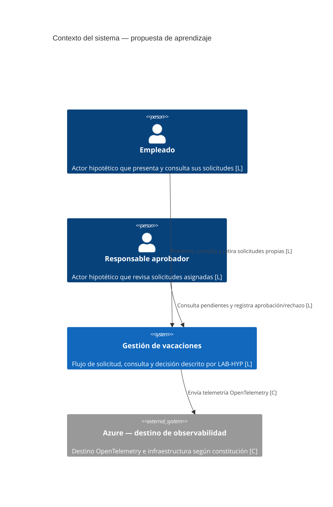
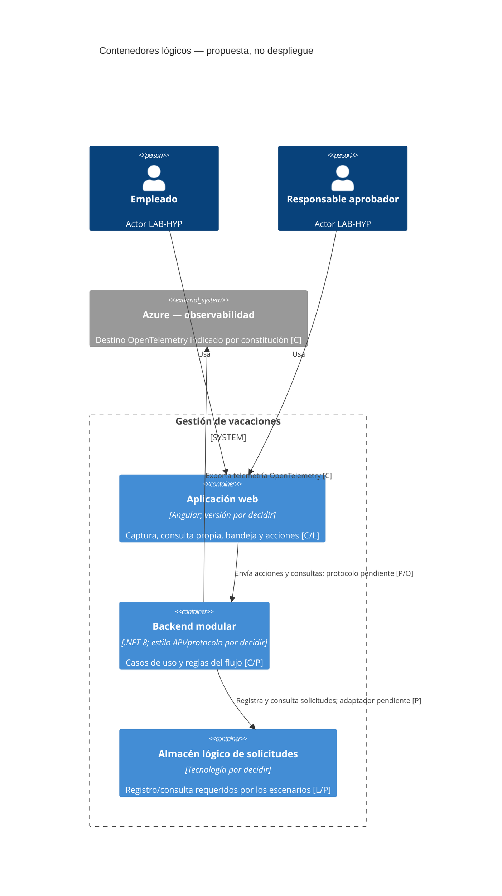
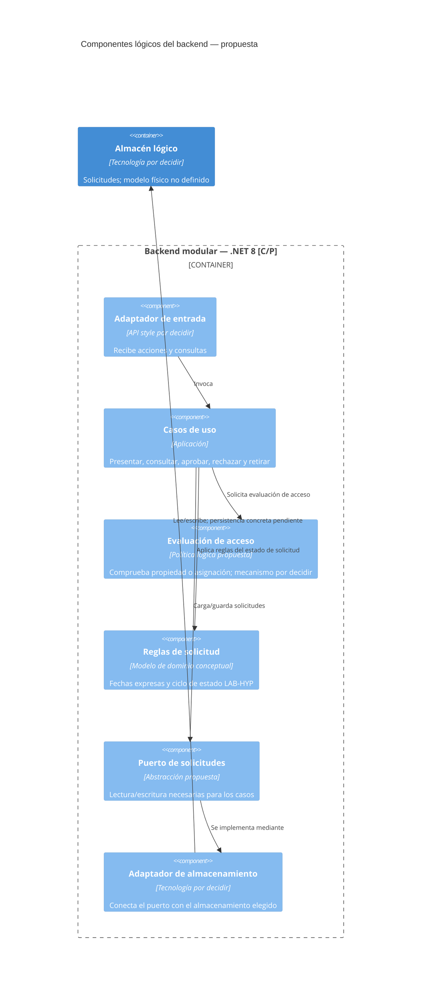
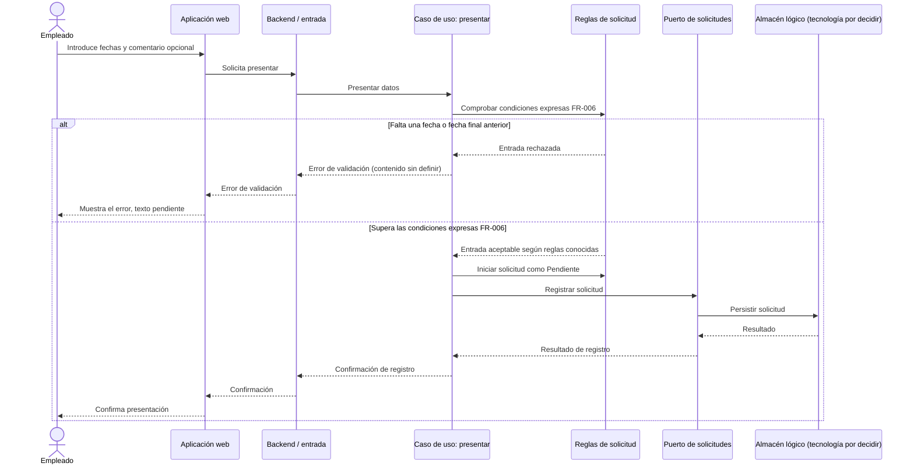
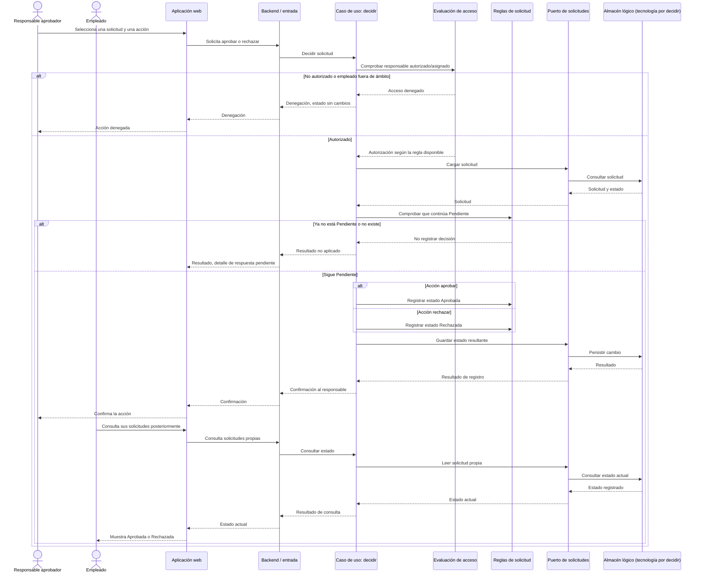
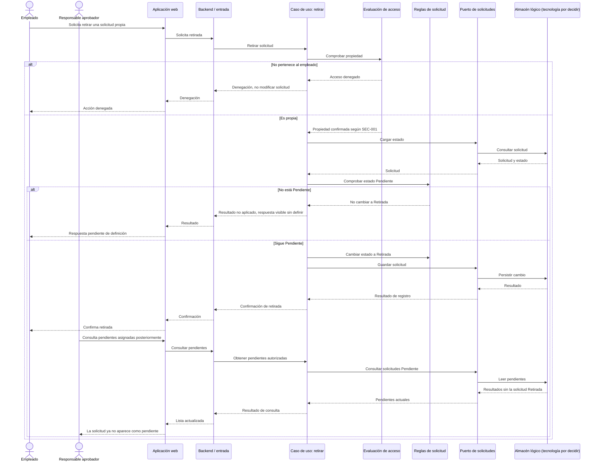

# Propuesta de arquitectura: Gestión de vacaciones

**Fecha:** 2026-10-27  
**Estado:** Propuesta para proyecto personal de aprendizaje. No es una arquitectura aprobada por una organización ni valida requisitos con stakeholders reales.

## Claves de evidencia

- **[C] Constitución:** decisión vinculante aprobada en la constitución vigente.
- **[L] Laboratorio:** comportamiento o alcance descrito en artefactos LAB-HYP; es material de aprendizaje, no requisito de producto validado.
- **[P] Propuesta:** elección arquitectónica recomendada para este ejercicio; no es vinculante hasta aceptarla.
- **[O] Abierto:** dato, objetivo o decisión no resueltos por las fuentes.

Los diagramas y las tablas indican estas categorías. Una propuesta no convierte una pregunta de negocio en respuesta.

## Resumen

**[P]** Para aprender con una solución pequeña y coherente, se propone una aplicación web Angular y una aplicación backend .NET 8 organizada como monolito modular, con comunicación síncrona y una frontera lógica de persistencia detrás de un puerto. El almacenamiento se representa de forma lógica, sin seleccionar motor, servicio ni esquema. No se proponen microservicios, broker, event sourcing ni identidad externa.

**[C]** La constitución fija Angular (versión sin decidir), C#/.NET 8, desarrollo local con Podman, GitHub Actions, Terraform, despliegues rolling, GitHub Flow, OpenTelemetry hacia Azure, controles de seguridad seleccionados y umbrales de pruebas.

**[L]** El laboratorio cubre presentar solicitudes con fecha inicial/final y comentario opcional; validar ausencia de fechas o intervalo invertido; consultar solicitudes propias o pendientes asignadas; aprobar, rechazar o retirar una solicitud pendiente. El ciclo hipotético es `Pendiente → Aprobada | Rechazada | Retirada`.

**[O]** No hay features aprobadas del producto. Están sin decidir estilo arquitectónico constitucional, API/protocolo, base de datos, proveedor de identidad, autorización concreta, asignación de responsables, objetivos NFR y varias reglas de negocio.

## Contexto y frontera

**[L] Actores hipotéticos:**

- **Empleado:** presenta solicitudes, consulta las propias y puede retirar una propia mientras siga pendiente.
- **Responsable aprobador:** consulta solicitudes pendientes de empleados asignados y puede aprobarlas o rechazarlas si está autorizado.

**[L] Sistema dentro de la frontera:** flujo centralizado de solicitudes, validación mínima de fechas, consulta de solicitudes y registro del resultado. La baseline no describe otros sistemas de negocio ni integraciones.

**[C] Sistema externo de soporte:** Azure es el destino de OpenTelemetry; Resource Health y Activity Logs están seleccionados para monitorización de infraestructura. Esta relación operativa no implica una integración funcional de vacaciones.

**[O]** No se especifica proveedor de identidad, sistema de RR. HH., nómina, calendario corporativo ni fuente de asignación. No se añaden al contexto como dependencias del producto.

## Drivers y restricciones

| Categoría | Driver / restricción | Implicación para esta propuesta |
| --- | --- | --- |
| [C] | Proyecto greenfield y full-stack; backend C#/.NET 8; frontend Angular sin versión fijada. | La propuesta separa interfaz y backend, sin fijar versión de Angular. |
| [C] | Podman para desarrollo local. | No implica que el entorno de producción use contenedores u orquestador concreto. |
| [C] | GitHub Actions, Terraform, GitHub Flow, despliegue rolling y entornos dev/uat/prod; `pre` deshabilitado. | El overview no elige destino de despliegue. |
| [C] | Pipeline con build, lint/format, pruebas, pruebas de arquitectura, mutation, security scan y container scan; 80 % cobertura unitaria, 60 % mutación y 0 críticos en scans. | Calidad y escaneo son gates de entrega, no objetivos de disponibilidad o rendimiento. |
| [C] | OpenTelemetry hacia Azure; Resource Health y Activity Logs. | La propuesta instrumenta límites de interacción y correlación; no fija métricas ni umbrales. |
| [C] | VNet, Private Endpoints, Azure Front Door WAF; TLS 1.2+; claves administradas por Azure para cifrado en reposo; PII cifrada. | Son restricciones de seguridad. La plataforma exacta de ejecución y el tratamiento de datos que sean PII siguen necesitando diseño. |
| [C] | GDPR y HIPAA aparecen seleccionados en la constitución. | No equivale a declarar cumplimiento: alcance, controles, responsables y evidencia siguen pendientes. |
| [C] | Configuración mediante appsettings/archivos de entorno; .NET User Secrets local; sin feature flags. | No se añade un proveedor de configuración ni de secretos de producción no seleccionado. |
| [C] | El trigger dev indicado (`commit` en `develop`) contradice GitHub Flow; prod requiere aprobación manual. | Confirmar el trigger dev antes de automatizar despliegues. |
| [L] | Los escenarios son de solicitud individual; las reglas expresas se limitan a presencia de fechas y orden del intervalo. | Mantener el dominio acotado y no codificar saldo, calendario laboral ni reglas no especificadas. |
| [L] | SEC-001 limita visibilidad/acciones a solicitudes propias o asignadas. | La autorización debe distinguir propiedad y asignación, aunque su mecanismo no esté definido. |
| [O] | La constitución no selecciona estilo de backend/frontend, CQRS, event sourcing, comunicación, base de datos, data access, identity provider, modelo de autorización, API style, API gateway ni plataforma de ejecución. | Se proponen solo límites lógicos; las elecciones tecnológicas permanecen abiertas. |
| [O] | No hay objetivos de rendimiento, disponibilidad, capacidad, accesibilidad, retención, recuperación ni frescura de estado. | No atribuir SLO, SLA, RTO/RPO ni capacidad a esta propuesta. |

## Estilo arquitectónico propuesto

### Propuesta principal

**[P] Monolito modular para backend + SPA única para frontend.** El backend se organiza por capacidades de aplicación y separa entrada, casos de uso, reglas del dominio y adaptadores. La SPA Angular consume una interfaz de aplicación síncrona cuyo API style y protocolo aún deben seleccionarse.

**[L]** Las features componen un único flujo centralizado y el modelo conceptual no identifica contextos separados, eventos de dominio ni límites de agregados confirmados.  
**[P]** Un solo backend desplegable reduce la complejidad operativa del ejercicio y permite practicar límites modulares sin asumir despliegues independientes o consistencia eventual.

### Alternativas y trade-offs

| Alternativa | Evaluación para el laboratorio |
| --- | --- |
| **[P] Monolito modular** | Recomendado para este ejercicio: un solo sistema desplegable y límites internos comprobables. Trade-off: los módulos comparten ciclo de despliegue y escalan juntos. |
| **[P] Monolito tradicional** | Menos estructura inicial; puede facilitar el primer prototipo, pero ofrece menos presión útil para practicar separación por capacidades. No se descarta. |
| **[P] Microservicios** | No recomendados con la evidencia actual: no hay equipos, escalado independiente, contratos ni integraciones que justifiquen operación distribuida. Añaden red, despliegues, consistencia y observabilidad distribuida. |
| **[P] Event-driven / CQRS / event sourcing** | No recomendados como punto de partida: no hay requerimiento asíncrono, consumidores de eventos ni asimetría de lectura/escritura documentados. Broker, CQRS y event sourcing no están seleccionados en la constitución. |
| **[P] Serverless** | Alternativa posible, pero no seleccionada y sin cargas, límites operativos ni plataforma que la justifiquen. |

**[C]** La constitución deja sin marcar el estilo de arquitectura. Por tanto, “monolito modular” y “SPA única” son decisiones propuestas para el aprendizaje, no decisiones constitucionales. CQRS, event sourcing y comunicación síncrona/asíncrona tampoco están seleccionados.

## Contenedores y componentes lógicos

**[P]** La siguiente vista es lógica; no representa máquinas, servicios cloud, red de despliegue, protocolo ni selección de base de datos.

- **[C] Aplicación web:** Angular; versión pendiente.
- **[C] Backend:** C#/.NET 8. **[P]** Un único backend modular que expone una frontera de aplicación para comandos y consultas; REST, GraphQL, gRPC o estilo de endpoint no están elegidos.
- **[P] Almacén lógico de solicitudes:** necesario para sostener el registro y las consultas del escenario. Motor, esquema, despliegue y tecnología están sin seleccionar.
- **[C] Observabilidad:** instrumentación OpenTelemetry con destino Azure. **[O]** Exporter, configuración de datos personales, retención de telemetría y alertas específicas requieren concreción.

### Componentes lógicos del backend

**[P]** Los nombres siguientes son responsabilidades propuestas, no clases, servicios ni contratos ya existentes.

**[L]** El dominio documenta fechas, comentario opcional, estados y acciones, pero no justifica aún una raíz de agregado, un servicio de dominio, eventos, value objects completos ni una entidad de decisión. **[P]** La propuesta encapsula reglas conocidas dentro de un componente lógico de dominio sin elevar esos elementos no demostrados a tipos DDD confirmados.

## Flujos principales

### Presentar una solicitud

**[L]** El empleado envía dos fechas y, opcionalmente, un comentario. Si falta una fecha o la fecha final precede a la inicial, no se crea una solicitud pendiente; el texto exacto del error está abierto.  
**[P]** La secuencia muestra interacción síncrona y un puerto de persistencia lógico, sin protocolo ni motor elegidos.

**[O]** Formato y zona horaria, criterios de “intervalo aceptado” adicionales, contenido/canal de confirmación y conducta ante error de persistencia siguen abiertos (LAB-OQ-002/004; Q-002/009/010/020/024).

### Aprobar o rechazar

**[L]** Un responsable autorizado, asignado al empleado, puede resolver una solicitud que continúa pendiente. La aplicación registra `Aprobada` o `Rechazada`; el empleado puede consultar el estado actualizado.  
**[P]** Se usa una sola secuencia con ramas de resultado porque aprobación y rechazo comparten condiciones y difieren en el estado resultante.

**[O]** No se define el mecanismo de identidad/autorización, la fuente de asignación, el motivo de rechazo, la respuesta para una solicitud inexistente, concurrencia, confirmación de persistencia, propagación del estado ni notificación externa (LAB-OQ-003/006/007/008; Q-003/004/006/007/013/016/022/024).

### Retirar una solicitud

**[L]** El empleado puede retirar una solicitud propia solo mientras siga `Pendiente`; tras ello figura `Retirada` y deja de estar en la bandeja de pendientes.  
**[P]** La comprobación de propiedad y estado se sitúa antes de aplicar el cambio. No se añade “En revisión” como estado, ni una política nueva para ese caso.

**[O]** El resultado ante fallo de persistencia, cambio concurrente, “En revisión”, confirmación explícita y actualización de consultas no está especificado (LAB-OQ-006/008; Q-003/023/024).

## Datos, identidad y autorización

| Tema | Evidencia / propuesta / pendiente |
| --- | --- |
| Datos de solicitud | **[L]** Fecha inicial, fecha final, comentario opcional y estado. No se especifican identificador, tipos concretos, campos adicionales ni esquema. |
| Propiedad de datos | **[L/O]** El empleado consulta solicitudes propias; la organización y el propietario de datos/fuente de verdad no están identificados (Q-014). **[P]** Para el ejercicio, mantener el ciclo de solicitud dentro del límite de Gestión de vacaciones evita crear un sistema de registro externo no evidenciado; no implica propiedad legal u organizativa. |
| Asignación | **[L/O]** Las consultas y decisiones del responsable dependen de empleados asignados. Fuente, propietario, cardinalidad, vigencia y sustituciones están pendientes (LAB-OQ-003; Q-006/007/014). No se crea un módulo de administración de asignaciones. |
| Identidad | **[C/O]** El proveedor de identidad y el modelo de autorización siguen sin seleccionar. Los flujos de autenticación de la constitución aparecen sin habilitar. No se asume Microsoft Entra ID ni otro proveedor. |
| Autorización | **[L]** Empleado sobre sus solicitudes; responsable sobre solicitudes de empleados asignados, con autorización para decidir. **[P]** Aplicar una comprobación centralizada por caso de uso y operación, manteniendo separadas las reglas de propiedad y asignación. **[O]** RBAC/claims/policies/ABAC, claims y proceso de asignación no están decididos. |
| Historial | **[L/O]** El estado actual se registra; no se exige historial de cambios, auditoría de decisiones ni actor/fecha de cada cambio (LAB-OQ-008; Q-015/016). |
| Clasificación de datos | **[C]** PII debe cifrarse según constitución. **[O]** No está determinado qué campos del laboratorio se clasificarían como PII ni la retención o eliminación aplicable. |

## Observabilidad, resiliencia y seguridad

### Observabilidad

- **[C]** OpenTelemetry hacia Azure; Resource Health y Activity Logs seleccionados para infraestructura.
- **[P]** Añadir trazas correlacionadas entre UI/backend y operaciones de presentar, consultar, decidir y retirar; evitar incluir comentarios, fechas sensibles o identificadores personales en atributos de telemetría salvo evaluación y aprobación.
- **[O]** Esquema de atributos, muestreo, alertas, dashboards, retención y objetivos operativos no están definidos. No se inventan umbrales.

### Resiliencia

- **[L/O]** Los UCs identifican fallos de consulta/registro y concurrencia como comportamientos abiertos; no fijan reintentos, consistencia, idempotencia, recuperación ni mensajes.
- **[P]** Mantener los cambios de estado como operaciones síncronas dentro del caso de uso propuesto y no añadir broker ni reintentos automáticos hasta definir semántica y garantías. El diagrama no prescribe transacción ni tecnología.
- **[C]** La estrategia de despliegue seleccionada es rolling. **[O]** Compatibilidad de datos entre versiones, rollback, backup, RTO/RPO y destino de ejecución requieren decisión posterior.

### Seguridad

- **[C]** VNet, Private Endpoints y Azure Front Door WAF; TLS 1.2+; cifrado en reposo con claves administradas por Azure; PII cifrada; security scans configurados con cero críticos.
- **[L]** SEC-001 exige acceso limitado a solicitudes propias/asignadas y denegación de accesos ajenos.
- **[P]** Aplicar mínimo privilegio y validar autorización en backend, no confiar solo en ocultar acciones en la interfaz.
- **[O]** Proveedor/modelo de identidad, autorización concreta, auditoría, retención, secretos de producción y alcance de controles para GDPR/HIPAA no están resueltos. Los estándares seleccionados no son una declaración de cumplimiento logrado.

## Mapeo de requisitos no funcionales

| Categoría | Evidencia/estado | Propuesta de respuesta arquitectónica | Pendiente / límite |
| --- | --- | --- | --- |
| Rendimiento | **[L/O]** No hay objetivo medible (LAB-OQ-010; Q-019). | **[P]** Medir flujos de consulta y escritura antes de optimizar. | No se fija latencia, throughput, caché ni capacidad. |
| Disponibilidad y recuperación | **[L/O]** No hay objetivo, RTO ni RPO (LAB-OQ-010). | **[P]** Instrumentar salud y documentar escenarios de fallo cuando existan requisitos. | No se proponen réplicas, zonas, SLA ni estrategia de backup. |
| Seguridad y privacidad | **[C]** Red, TLS, cifrado, WAF, PII cifrada y escaneos de seguridad seleccionados. **[L]** SEC-001 acota acceso. | **[P]** Centralizar la evaluación de autorización en el backend y no exponer datos fuera del ámbito solicitado. | Identidad, autorización, clasificación, auditoría, privacidad, retención y controles de cumplimiento pendientes. |
| Accesibilidad | **[L/O]** Sin requisitos/umbrales (Q-019). | **[P]** Evaluar accesibilidad de interfaz cuando se definan criterios. | No se afirma conformidad ni nivel WCAG. |
| Retención y ciclo de vida de datos | **[L/O]** No definida (LAB-OQ-008/009; Q-014/015). | **[P]** Mantener decisión explícita de retención antes de uso con datos reales. | No se inventa duración, borrado ni archivo. |
| Observabilidad | **[C]** OpenTelemetry → Azure, Resource Health y Activity Logs. | **[P]** Trazas correlacionadas por operación, sin PII innecesaria. | Umbrales, alertas, retención de telemetría y tratamiento de datos pendientes. |
| Mantenibilidad | **[C]** .NET 8, Angular, pruebas de arquitectura; 80 % cobertura unitaria y 60 % mutación. | **[P]** Límites modulares y dependencias hacia dentro; validar con pruebas de arquitectura. | El estilo de arquitectura aún no está aprobado. |
| Compatibilidad/despliegue | **[C]** GitHub Actions, GitHub Flow, rolling, dev/uat/prod y aprobación manual para prod. | **[P]** Separar build/test de despliegue y promover artefactos entre entornos, sujeto a flujo real. | Trigger `develop` contradice GitHub Flow; plataforma y promoción UAT pendientes. |

## Decisiones abiertas y trazabilidad

### Decisiones constitucionales pendientes

- **[O]** Estilo backend y frontend, API style/protocolo, API gateway, versión/rate limiting.
- **[O]** Base de datos, acceso a datos, uso de repositorio y Unit of Work.
- **[O]** CQRS, comunicación síncrona/asíncrona, broker y event sourcing.
- **[O]** Proveedor y flujo de identidad, modelo de autorización y gestión de secretos en producción.
- **[O]** Plataforma de ejecución, estrategia de contenedores/orquestación y alcance de infraestructura.
- **[O]** Resolver el trigger de dev (`develop`) frente a GitHub Flow.

### Preguntas del laboratorio que afectan arquitectura

- **[O] LAB-OQ-003 / Q-006 / Q-007:** propietario, fuente, cardinalidad y cambios de asignación empleado–responsable.
- **[O] LAB-OQ-005:** si se calcula/muestra/reserva saldo y qué política/fuente lo gobierna; explícitamente fuera del alcance actual.
- **[O] LAB-OQ-006 / Q-003 / Q-004 / Q-023:** semántica de “En revisión”, edición, retirada, reapertura y reversión.
- **[O] LAB-OQ-007 / Q-011:** contenido y obligatoriedad del comentario/motivo de rechazo.
- **[O] LAB-OQ-008 / Q-013–Q-016:** identidad, autorización, privacidad, propiedad de datos, auditoría y retención.
- **[O] LAB-OQ-009 / Q-017 / Q-018:** existencia, dirección, protocolo y errores de integraciones externas. No se representa ninguna integración de negocio en los diagramas.
- **[O] LAB-OQ-010 / Q-019 / Q-024:** umbrales NFR, fallos, concurrencia, consistencia y recuperación.
- **[O] Q-001:** el catálogo actual declara 0 features aprobadas; esta propuesta se mantiene como aprendizaje personal y no valida alcance de negocio.

### Fuentes usadas

- **[C]** [Resumen de constitución](../../../.boltf/memory/constitution.digest.md) y [constitución canónica](../../../.boltf/memory/constitution.md).
- **[L]** [Baseline LAB-HYP](../../../specs/lab/requirements-baseline.md) y [resumen de aclaraciones](../../../specs/clarification-summary.md).
- **[L]** [LAB-F001](../../../specs/lab-001-submit-vacation-request/requirements/requirements.md) / [UC-001](../../../specs/lab-001-submit-vacation-request/requirements/use-cases/UC-001.md) / [Gherkin](../../../specs/lab-001-submit-vacation-request/tests/submit-vacation-request.feature).
- **[L]** [LAB-F002](../../../specs/lab-002-validate-vacation-date-range/requirements/requirements.md) / [UC-002](../../../specs/lab-002-validate-vacation-date-range/requirements/use-cases/UC-002.md) / [Gherkin](../../../specs/lab-002-validate-vacation-date-range/tests/validate-vacation-date-range.feature).
- **[L]** [LAB-F003](../../../specs/lab-003-view-own-vacation-requests/requirements/requirements.md) / [UC-003](../../../specs/lab-003-view-own-vacation-requests/requirements/use-cases/UC-003.md) / [Gherkin](../../../specs/lab-003-view-own-vacation-requests/tests/view-own-vacation-requests.feature).
- **[L]** [LAB-F004](../../../specs/lab-004-view-assigned-pending-requests/requirements/requirements.md) / [UC-004](../../../specs/lab-004-view-assigned-pending-requests/requirements/use-cases/UC-004.md) / [Gherkin](../../../specs/lab-004-view-assigned-pending-requests/tests/view-assigned-pending-requests.feature).
- **[L]** [LAB-F005](../../../specs/lab-005-approve-vacation-request/requirements/requirements.md) / [UC-005](../../../specs/lab-005-approve-vacation-request/requirements/use-cases/UC-005.md) / [Gherkin](../../../specs/lab-005-approve-vacation-request/tests/approve-vacation-request.feature) / [modelo de estados](../../../specs/lab-005-approve-vacation-request/requirements/state-model.md).
- **[L]** [LAB-F006](../../../specs/lab-006-reject-vacation-request/requirements/requirements.md) / [UC-006](../../../specs/lab-006-reject-vacation-request/requirements/use-cases/UC-006.md) / [Gherkin](../../../specs/lab-006-reject-vacation-request/tests/reject-vacation-request.feature).
- **[L]** [LAB-F007](../../../specs/lab-007-withdraw-pending-vacation-request/requirements/requirements.md) / [UC-007](../../../specs/lab-007-withdraw-pending-vacation-request/requirements/use-cases/UC-007.md) / [Gherkin](../../../specs/lab-007-withdraw-pending-vacation-request/tests/withdraw-pending-vacation-request.feature).
- **[L]** [Modelo conceptual](../ddd/vacation-management/domain-model.md).

> **Sin cambios de alcance:** este documento no crea ADR, código, contratos API, esquemas de base de datos, infraestructura ni plan de implementación. Las propuestas quedan sujetas a revisión y no convierten los requisitos LAB-HYP en aprobados.
