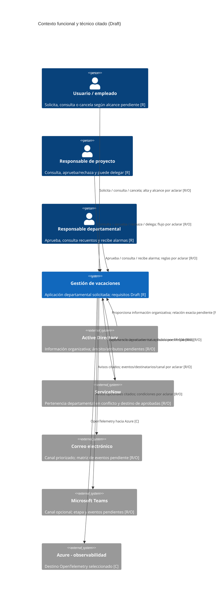

# Arquitectura general: Gestión y aprobación de vacaciones

| Propiedad | Valor |
| --- | --- |
| Estado | Draft; propuesta para revisión, no arquitectura aprobada |
| Escenario | fullstack: backend C#/.NET 8 y frontend Vue.js, versión sin fijar |
| Paso del laboratorio | 10. Arquitectura de la solución |
| Evidencia funcional | RFP y baseline Draft; PA-01–PA-27 abiertas, sin respuestas validadas |
| Decisiones técnicas vinculantes usadas | Digest de constitución y ADR-0001/ADR-0004; ADR-0003 solo en sus decisiones registradas |

## 1. Resumen y límites

El RFP describe una aplicación departamental para solicitudes y aprobación de vacaciones, consultas
por periodo/proyecto/departamento, cancelación, alarmas, notificaciones e intercambio con ServiceNow,
Active Directory, correo y Teams. Las doce Features y catorce UCs actuales son candidatos `Draft`;
no contienen criterios de aceptación aprobados.

El Paso 9 está **bloqueado**: no hay criterios de aceptación aprobados de los que derivar Gherkin. No
se inventan recorridos para completar la arquitectura. Los UC existentes son escenarios candidatos,
no prueba de un flujo aceptado ni una autorización definida.

Este documento separa:

- **[C] Decisión vinculante de constitución/ADR:** tecnología o control explícitamente seleccionado.
- **[R] Evidencia funcional:** petición contenida en RFP/baseline, todavía Draft y no aprobada por negocio.
- **[P] Propuesta arquitectónica de las fuentes:** opción mostrada en S2 §5 o S3, no decisión de esta arquitectura.
- **[O] Abierto:** contradicción, falta de definición o selección pendiente, con PA-* asociada.

No se selecciona estilo arquitectónico, API, base de datos, ORM, hosting, orquestador, proveedor de
identidad, modelo de autorización o protocolo. No se afirma que haya una aplicación desplegada,
integraciones operativas, controles implementados o cumplimiento conseguido. El alcance funcional
citado permanece en un departamento (BL-RT-005); no se amplía por los mockups.

## 2. Contexto del sistema

### Actores y sistemas nombrados

| Participante | Evidencia y relación descrita | Límite pendiente |
| --- | --- | --- |
| Usuario / empleado solicitante | **[R]** Solicita y puede cancelar vacaciones (RFP §3.1; BL-RF-015). Consulta vacaciones pasadas/aprobadas/no aprobadas (BL-RF-011–013). | PA-16: actor, ámbito de consulta y datos/reglas de alta. No se asume que consulta únicamente solicitudes propias. |
| Responsable de proyecto | **[R]** Consulta y puede aprobar/rechazar; aparece delegación dentro del proyecto (BL-RF-031, BL-RF-045–048, BL-RF-050). | PA-05/PA-06/PA-12/PA-26: alcance, autorización, flujo y semántica. |
| Responsable departamental | **[R]** Puede aprobar, conocer recuentos departamentales y recibir una alarma por demora (BL-RF-030/032/049/051). | PA-05/PA-11/PA-13: relación entre niveles, cobertura y plazo. |
| ServiceNow | **[R]** Se cita para pertenencia departamental y como destino de vacaciones aprobadas (BL-RF-036, BL-RF-021–023). | PA-02/PA-18: pertenencia fuente de verdad, contrato, formato, cadencia y confirmación. |
| Active Directory | **[R]** Se cita para información organizativa y relaciones de proyecto (BL-RT-001, BL-RF-038/039); RF-037 le atribuye además pertenencia departamental. | PA-02: conflicto con pertenencia departamental de ServiceNow. |
| Correo electrónico | **[R]** Canal priorizado para información/avisos (BL-RF-017/018/027/029/032; Discovery). | PA-17: eventos, destinatarios, contenido y evidencia. No se elige proveedor o transporte. |
| Microsoft Teams | **[R]** Canal expresado como opcional; tarjetas adaptativas posteriores (BL-RF-025/028/029). | PA-17/PA-22: eventos, opción, audiencia y etapa. No se elige bot, webhook o API. |
| Azure | **[C]** Destino de OpenTelemetry; además hay controles de red/cifrado seleccionados en constitución. | No implica que sea el hosting de la aplicación ni que exista despliegue. RT-003 cita Azure o Amazon; ADR-0003 mantiene delivery como propuesta. |

«Admin», «Gerente» y otros actores de diagramas/mockups no se incorporan como actores autorizados.
Tampoco se deduce una matriz de acceso a partir de que se nombren responsables.

### Diagrama de contexto

El diagrama expresa interacciones citadas en RFP/baseline. Las etiquetas indican incertidumbre; no son
contratos ni permisos. La aplicación es un límite conceptual, no un sistema ya implementado.



La relación de datos organizativos no afirma sincronización, autoridad de fuente o sincronización
recíproca. ServiceNow aparece tanto en RF-036 como en RF-021; Active Directory aparece en RT-001 y
RF-037–039. La pertenencia departamental entre ServiceNow y AD está en conflicto (PA-02). MyScaturing
y «Google» no se dibujan como sistemas: PA-23 conserva esos términos dudosos.

## 3. Drivers y requisitos de calidad

### Drivers funcionales trazados

| Driver | Evidencia fuente | Estado y efecto arquitectónico |
| --- | --- | --- |
| Consultar vacaciones pasadas, aprobadas/no aprobadas y solicitudes por responsables | BL-RF-010–013/045; F-001/F-002 y UC-001–UC-003 | **[R/O]** Consultas citadas; actor, alcance, categorías y autorización sin cerrar (PA-16/PA-26). No se fijan read models, filtros o permisos. |
| Recuentos por periodo/nivel y visualización de concentración | BL-RF-001–005/009/040–044/049; F-003; UC-004/UC-005 | **[R/O]** Fórmula, jerarquía, unidades y población de referencia pendientes (PA-01/03/08/09). RF-009 cita semanas de julio >70 % como ejemplo, no cupo general ni rechazo automático. |
| Aprobación por proyecto/departamento, rechazo, delegación y cancelación | BL-RF-006/014–016/019/023/030–035/046–048/050–051; F-005–F-008 | **[R/O]** Acciones citadas; estados, origen/destino, precedencia, cobertura y efectos abiertos (PA-05/06/11–15). Los state-models F-005/F-006/F-008 describen esos bloqueos; no presuponen estados formales. |
| Notificar eventos, acceder por enlace y exportar aprobadas | BL-RF-017/018/020–029; F-010/F-011; UC-012–UC-014 | **[R/O]** Destinatarios, matriz evento/canal, acceso, contrato y tratamiento de errores sin cerrar (PA-17/18/22). RF-023 hace que F-011 dependa de aprobaciones requeridas de F-005; no al revés. |
| Presentar una nueva solicitud | Objetivo del RFP §1/§3.1; F-012 | **[R/O]** No hay BL-FR específico de alta; campos, validación y estado inicial no modelables (PA-16/PA-26). No diseñar un formulario o flujo de creación por inferencia. |

### Requisitos no funcionales

| Fuente | Enunciado | Tratamiento arquitectónico en este Draft |
| --- | --- | --- |
| BL-RNF-001 | 500 usuarios a la vez | **[O]** Concurrencia y carga no aclaradas (PA-19). No dimensionar ni atribuir capacidad a un estilo/plataforma. Distinto del volumen departamental. |
| BL-RNF-009 | Aproximadamente 500 personas del departamento | **[R/O]** Población, no usuarios concurrentes. Aclarar su relación con RNF-001 (PA-19). |
| BL-RNF-002–005 | «Muy visual», «sencilla», «fácilmente», «fácil de ver» | **[O]** Sin medidas verificables (PA-21). No fijar colores, clics, tiempos, nivel WCAG o dispositivos. |
| BL-RNF-006 | No se requiere sincronización en tiempo real | **[R]** Aplica a sincronización según el enunciado; no fija cadencia por interfaz ni conducta interactiva local. Descarga nocturna se cita en RF-020/Discovery, pero alcance/hora de cada intercambio siguen abiertos (PA-18). |
| BL-RNF-007/010 | Uso y escalabilidad estacionales | **[R/O]** Picos cualitativos, sin perfil de carga o calendario aceptado (PA-20). |
| BL-RNF-008 | Optimizar coste operativo | **[O]** Sin presupuesto o métrica de ahorro (PA-20). No hay estrategia de autoescalado adoptada. |

No se trasladan valores de plantilla como P95, uptime, throughput, RTO/RPO o número de usuarios
adicionales. El Paso 9 no produjo escenarios: faltan criterios de aceptación aprobados; no se usa un
Gherkin hipotético como driver arquitectónico.

## 4. Decisiones vinculantes y límites

### Decisiones que sí se aplican

| Identificador | Decisión vinculante | Consecuencia en esta propuesta |
| --- | --- | --- |
| ADR-0001 / constitución | Backend C#/.NET 8 (LTS). | Stack de backend registrado; no selecciona arquitectura, API, ORM o persistencia. |
| ADR-0004 / constitución | Frontend Vue.js, versión no fijada. | Stack frontend registrado; no seleccionar librería UI, routing o gestión de estado. |
| Constitución / ADR-0003 | Podman para desarrollo local; GitHub Actions; Terraform; despliegue rolling; GitHub Flow; gates 80 % unitarias / 60 % mutation; OpenTelemetry → Azure. | Aplicar como restricciones de desarrollo/entrega y observabilidad; no deducir plataforma de producción, contenedores de ejecución o topología. |
| Constitución / ADR-0003 | VNet, Private Endpoints, WAF, claves administradas por Azure y cifrado PII seleccionados. | Restricciones de seguridad para diseño/despliegue cuando aplique; no son evidencia de que los controles estén desplegados ni de clasificación de cada campo. |
| Constitución | GDPR e HIPAA seleccionados en inicialización. | No afirmar aplicabilidad o cumplimiento. ADR-0003 deja explícita la necesidad de confirmar aplicabilidad y evidencia. |
| Constitución | Entornos dev/uat/prod; `pre` deshabilitado. | Configuración de entornos no fija todavía dónde se alojará la aplicación. |

### Decisiones no tomadas

El estilo arquitectónico, estilo/protocolo de API, base de datos, tecnología de acceso a datos,
proveedor de identidad, modelo de autorización, servicio de hosting/orquestación y contratos de
integración siguen sin seleccionar (constitución/ADR-0001, ADR-0003; PA-24). Vue.js no incluye versión
(ADR-0004; PA-27). El disparador `develop` para dev contradice GitHub Flow y queda pendiente antes
de implementar CD (constitución/ADR-0003).

### Decisiones del laboratorio · Paso 16.2, Bolt 1 (F-006)

Confirmadas por el usuario el 2026-10-30 solo para el laboratorio
([#74](https://github.com/jCabreraMartin/vacation-management/issues/74)). No son decisiones aprobadas
para el cliente ni ADR; las decisiones de la sección anterior siguen abiertas.

- **Backend** (`src/backend`): ASP.NET Core Minimal API sobre .NET 8, organizado en Domain,
  Application, Infrastructure y Api. Las dependencias apuntan hacia Domain y se comprueban con
  NetArchTest.
- **Persistencia:** repositorio en memoria tras un puerto de Application, con datos semilla ficticios.
  No elige base de datos. Tras A-01, devuelve snapshots y guarda mediante comparación condicional
  por solicitud; dos rechazos del mismo estado producen un éxito y un conflicto sin un bloqueo global.
- **Identidad y autorización:** ninguna; actor «responsable» implícito. Riesgo aceptado solo para el
  laboratorio, sin uso fuera de un entorno local. A-02 impone listeners HTTP loopback configurados
  mediante `--urls` (por defecto `http://localhost:5080`); rechaza otras interfaces y endpoints
  Kestrel alternativos. No hay autenticación corporativa.
- **Frontend** (`src/frontend`): Vue 3 + TypeScript + Vite; durante el desarrollo, el servidor de Vite
  redirige `/api` al backend local.
- **Contrato del Bolt:** `GET /api/vacation-requests/{id}` y
  `POST /api/vacation-requests/{id}/rejection`. Los errores usan Problem Details: 404 si no existe y
  409 si la solicitud no está pendiente. Las escrituras requieren `X-Laboratory-Request: 1` y,
  si hay `Origin`, debe ser el origen del backend o el frontend local de puerto 5173
  (`localhost`, `127.0.0.1` o `[::1]`); otros orígenes, hosts no loopback o falta de cabecera reciben
  403. La cabecera no es un secreto ni una identidad: protege frente a escrituras simples ajenas,
  sin habilitar CORS. No es un contrato aprobado para otras Features.
- **Respuestas inciertas:** A-03 controla fallos de lectura JSON. Un fallo tras POST no confirma
  éxito ni ausencia de escritura; bloquea otro rechazo hasta «Comprobar estado» mediante GET manual.
  No hay reintentos automáticos.
- **Fuera:** despliegue, observabilidad OpenTelemetry, integraciones y estado compartido entre
  procesos.

## 5. Componentes y responsabilidades lógicas

La propuesta S2 §5.2 describe presentación, aplicación/API, dominio, integración, persistencia,
procesos programados y seguridad. Son **responsabilidades candidatas**, no módulos desplegables,
contenedores, contratos o límites DDD aprobados. Se propone mantenerlas como límites de análisis
hasta que se aclaren dependencias y decisiones; no se selecciona monolito modular solo porque S2 §5.1
lo recomiende.

| Responsabilidad lógica | Evidencia | Estado / límite |
| --- | --- | --- |
| Presentación web | Vue.js [C]; link/calendarios/consultas/acciones [R] | Necesidad de interfaz respaldada; rutas, navegación, componentes, sesiones y permisos TBD (PA-16/22/27). |
| Casos de uso de consulta | BL-RF-001–005/009–013/040–045/049 | Capacidades citadas en Features; filtros, alcance y proyecciones TBD. No materializar una capa concreta en código. |
| Casos de uso de solicitud y decisión | Objetivo RFP, BL-RF-006/015/016/019/023/030/031/035/047/050/051 | Aprobación/rechazo/cancelación citadas; alta sin BL-FR y flujo de estados incompleto. Mantener autorización como pendiente, sin algoritmo. |
| Coordinación de reglas de negocio | Propuesta de capas de S2 §5.2 | No hay agregado, servicio de dominio o regla completa confirmados. No diseñar componentes de dominio con invariantes inferidas. |
| Frontera de datos organizativos | BL-RF-036–039, BL-RT-001/004 | Necesaria en términos de integración; fuente de pertenencia ServiceNow/AD en conflicto (PA-02). |
| Frontera de datos de solicitudes | RF de consulta, aprobación, cancelación/exportación | Necesidad lógica de registrar/consultar; propiedad, persistencia, esquema y tecnología no seleccionados (PA-16/18/24). |
| Fronteras de salida | ServiceNow, correo, Teams | Necesidades citadas; contratos, protocolo, cadencia, garantías y matriz de eventos abiertos (PA-17/18). |
| Procesamiento temporal | RF-020/032, RNF-006 | Descarga nocturna y alarma por demora citadas, pero no se define scheduler, cola, worker, plazo o retry (PA-13/18). |
| Observabilidad | OpenTelemetry → Azure [C]; Resource Health/Activity Logs [C] | Selección de destino/monitorización; esquema de datos, retención, alertas de aplicación y métricas objetivo sin decidir. |

### Diagrama de componentes lógicos

Las cajas agrupan capacidades descritas por RF/Features o responsabilidades propuestas en S2 §5.2.
Las flechas marcadas TBD no constituyen contratos. No representan despliegue ni persistencia elegidos.

```mermaid
flowchart LR
    subgraph APP[Aplicación de gestión de vacaciones - límites lógicos Draft]
        WEB[Frontend Vue.js<br/>decisión registrada; versión TBD]
        BACK[Backend C#/.NET 8<br/>runtime registrado]
        QUERY[Consultas y recuentos<br/>alcance/fórmula TBD]
        REQUEST[Solicitud y decisiones<br/>reglas/modelo TBD; alta sin BL-FR específico]
        ORG[Integración organizativa<br/>fuente de pertenencia TBD]
        OUT[Exportaciones y avisos<br/>contratos/eventos TBD]
        DATA[Datos de solicitudes<br/>persistencia y propiedad TBD]
        WEB -->|protocolo/contrato TBD| BACK
        BACK --> QUERY
        BACK --> REQUEST
        BACK -.->|frontera propuesta| ORG
        BACK -.->|frontera propuesta| OUT
        QUERY -.->|datos/fórmula TBD| DATA
        REQUEST -.->|registro TBD| DATA
        OUT -.->|lectura de aprobadas; contrato TBD| DATA
    end

    AD[Active Directory<br/>alcance organizativo citado]
    SN[ServiceNow<br/>entrada en conflicto y salida citada]
    EMAIL[Correo<br/>canal priorizado; eventos TBD]
    TEAMS[Teams<br/>opcional; alcance TBD]
    AZURE[Azure<br/>destino OTel seleccionado]

    AD -.->|información organizativa; atributos TBD| ORG
    SN -.->|pertenencia RF-036; contradicción RF-037| ORG
    OUT -.->|solo aprobadas RF-021/022/023| SN
    OUT -.->|notificaciones RF-017/018/027/029/032; matriz TBD| EMAIL
    OUT -.->|opcional RF-028; condiciones TBD| TEAMS
    BACK -.->|OpenTelemetry [C]| AZURE
```

`REQUEST`, `DATA`, `ORG` y `OUT` son nodos explicativos para responsabilidades, no decisiones de
módulos. La consulta de datos de personas, reglas de aprobación y efectos de cancelación no pueden
concretarse más sin PA-01/02/05/14/16/18. La flecha `OUT` hacia ServiceNow no define qué significa
aprobación completa.

## 6. Datos: propiedad y procedencia

| Conjunto de datos | Evidencia de origen | Dirección/uso citado | Propiedad y modelo |
| --- | --- | --- | --- |
| Solicitudes de vacaciones | RFP §3.1 y BL-RF-006/010–023/030–032/045–051 | Consultar/decidir/cancelar/exportar en términos funcionales | No hay campos mínimos, propietario, clave, fuente de verdad o esquema definidos. El alta F-012 carece de BL-FR específico (PA-16). |
| Pertenencia departamental | BL-RF-036 frente a BL-RF-037; RT-001 | ServiceNow o AD hacia la aplicación, según requisitos en conflicto | Fuente y propietario por dato sin resolver (PA-02). |
| Relación proyecto/responsable | BL-RF-038/039; S1 T-06 resumida en RFP | Active Directory citado para información de proyecto/responsables | Atributos, correspondencia con proyectos y cardinalidad no definidos (PA-01/07). |
| Vacaciones aprobadas exportables | BL-RF-021–023 | Aplicación hacia ServiceNow, condicionada a aprobaciones requeridas | Formato, propiedad al recibir, acuse, retención e idempotencia no definidos (PA-05/18). |
| Eventos/notificaciones | BL-RF-017/018/027–029/032 | Correo priorizado y Teams opcional según Discovery | Payload, destinatarios, propietario y persistencia de notificaciones no definidos (PA-17). |

No se considera que la aplicación sea propietaria organizativa, que AD/ServiceNow sean sistemas de
registro en sentidos específicos, ni que sincronización implique réplica local. No se adopta un
modelo de datos desde la propuesta S2 §5.2, los mockups o el diagrama.

## 7. Integraciones

| Integración | Dirección respaldada | Evidencia | Pendiente antes de contrato |
| --- | --- | --- | --- |
| Active Directory | Entrada de información organizativa según RT-001 y relación proyecto/responsable citada | BL-RT-001, BL-RF-038/039; RFP S1 T-06 | Fuente/atributos/identificadores, acceso, protocolo, cadencia y errores (PA-02/07/18/24). RF-037 también lo asocia a pertenencia departamental, en conflicto. |
| ServiceNow | Entrada de pertenencia departamental según RF-036; salida de vacaciones aprobadas según RF-021–023 | BL-RF-036 y BL-RF-021–023; RT-004 | PA-02 para fuente de pertenencia; PA-05 para condición de aprobación; PA-18 para formato, cadencia, confirmación y errores. No es una interfaz bidireccional decidida. |
| Correo electrónico | Salida de información/avisos según RF-017/018/027/029/032 | BL-RF citados; Discovery expresa correo primero | PA-17: matriz de eventos, destinatarios, contenido, obligatoriedad y evidencia. Proveedor/protocolo no elegidos. |
| Microsoft Teams | Salida opcional según RF-028/029; tarjetas adaptativas posteriores según RF-025 | BL-RF-025/028/029 | PA-17/22: alcance, eventos, opción y etapa. No se eligen Graph/webhooks/bots. |

**Cadencia:** RNF-006 indica que no se requiere sincronización en tiempo real y RF-020 menciona una
descarga nocturna. Esto no establece que cada flujo sea nocturno ni fija hora o tolerancia. La
propuesta S2 §5 de integraciones programadas no es decisión. No se definen reintentos, fallback,
DLQ, consistencia ni garantías de entrega (PA-18).

## 8. Despliegue y límites de confianza

### Lo registrado por constitución/ADR

- **[C]** Frontend Vue.js y backend C#/.NET 8; versión Vue pendiente (ADR-0004/ADR-0001).
- **[C]** Podman para desarrollo local; esto no determina runtime productivo.
- **[C]** GitHub Actions, Terraform, despliegue rolling y GitHub Flow; el trigger dev `develop` contradice ese modelo y ADR-0003 lo deja pendiente.
- **[C]** OpenTelemetry hacia Azure, Resource Health y Activity Logs.
- **[C]** VNet, Private Endpoints, WAF, claves administradas por Azure y cifrado PII están seleccionados en constitución. Su implementación/aplicabilidad a cada flujo no está demostrada.
- **[C/O]** GDPR/HIPAA aparecen seleccionados por el asistente; ADR-0003 indica que aplicabilidad y evidencia de cumplimiento deben confirmarse.

### Límites pendientes

RT-003 habla de una nube existente como Azure o Amazon; S1 menciona disponibilidad de Azure y S2 §5
propone Azure. ADR-0003 es una propuesta de base de entrega, no aprobación del host de aplicación.
La constitución no selecciona AKS, Container Apps, App Service, Kubernetes, PaaS u otra topología.
No se dibuja un diagrama de despliegue ni se atribuye producción a Azure.

Como límite de diseño, la interacción web/backend y los sistemas externos requieren revisar flujos de
datos y accesos. Sin embargo, no hay una política de identidad/autenticación/autorización aprobada:
el modelo de autorización está sin seleccionar y los roles funcionales no conforman una matriz de
permisos (PA-16/24). No se asigna confianza, permiso o secreto específico a AD, ServiceNow, correo
o Teams por inferencia. Los controles constitucionales son restricciones de diseño, no prueba de
controles desplegados.

### Límites de confianza conceptuales

- **Navegador ↔ aplicación:** frontera lógica entre Vue.js y backend .NET 8. Protocolo,
  autenticación, autorización y contenido intercambiado están pendientes; no se dibuja un límite de
  red desplegado.
- **Aplicación ↔ AD/ServiceNow:** sistemas externos nombrados. Los datos/contratos se consideran
  fronteras por aclarar; la pertenencia departamental está en conflicto y no se define confianza,
  credenciales o dirección única para todos los intercambios.
- **Aplicación ↔ correo/Teams:** canales externos citados; eventos, destinatarios, datos y garantía
  de entrega siguen abiertos.
- **Aplicación ↔ persistencia:** frontera lógica necesaria para registrar/consultar según los
  requisitos, pero motor, despliegue, ownership y esquema no seleccionados.

Estos límites son preguntas de diseño, no zonas/subredes, políticas de firewall o controles de acceso
ya desplegados. Los controles constitucionales de red se deben considerar en una futura solución sin
convertirlos en prueba de que los límites de confianza anteriores ya estén materializados.

## 9. Identidad, autorización, seguridad y cumplimiento

| Área | Evidencia/decisión | Estado arquitectónico |
| --- | --- | --- |
| Identidad/autenticación | No hay IdP/flujo seleccionado en constitución; PA-16/PA-24 preguntan por actores y acceso. | Pendiente; no se elige Entra ID por tratarse de datos de AD. |
| Autorización | Actores y acciones aparecen en RF, pero no hay modelo de autorización elegido. | Pendiente; no se infiere RBAC, ABAC, claims o políticas. |
| Red | VNet, Private Endpoints y WAF seleccionados en constitución. | Restricciones de diseño; topología, ámbito y despliegue todavía deben decidirse. |
| Protección de datos | Claves administradas por Azure y cifrado de PII seleccionados. | Aplicar a datos clasificados como PII cuando se concrete clasificación; no se inventan campos o controles adicionales. |
| Cumplimiento | GDPR/HIPAA seleccionados por inicialización; aplicabilidad sin confirmar. | No afirmar cumplimiento ni definir retención/localización por inferencia (PA-24/PA-26). |
| Auditoría | La conversación asocia correo con auditoría y PA-17 pregunta qué evidencia se requiere. | No hay requisito confirmado de auditoría de decisiones, logs de negocio, conservación o acceso. |

La baseline no tiene requisitos SEC. Esta sección no crea requisitos funcionales de seguridad o
cumplimiento desde diagramas de ejemplo, ADR de plataforma o el asistente de inicialización.

## 10. Observabilidad y resiliencia

- **[C] Observabilidad:** OpenTelemetry hacia Azure; Resource Health y Activity Logs para infraestructura.
  No se define esquema de trazas, métricas, alertas, retención o indicadores de negocio.
- **[O] Fallos de consulta/registro/exportación/notificación:** las fuentes y UCs no fijan resultados,
  reintentos, compensación, circuit breaker, idempotencia o recuperación (PA-13/17/18). No se añaden
  como mecanismos decididos.
- **[O] Consistencia y cadencia:** no hay SLA, frescura, disponibilidad, RTO/RPO o garantía de exportación
  cuantificados. RNF-006 solo dice que no se requiere sincronización en tiempo real.
- **[C/O] Entrega:** rolling está seleccionado como estrategia, pero plataforma, compatibilidad,
  rollback y topología no se concretan aquí. El conflicto `develop`/GitHub Flow debe resolverse antes
  de automatizar el trigger de dev.

## 11. ADR candidatos y trade-offs pendientes

La propuesta arquitectónica S2 §5 recomienda web en capas, enfoque modular, monolito modular, Azure,
API de negocio, persistencia transaccional y procesos programados. Se registra como opción fuente
**[P]**, no como solución aceptada. S3 es un diagrama de propuesta, no despliegue real.

Las alternativas y trade-offs que aparecen en la matriz siguiente se mantienen como material de
evaluación. No se amplían con decisiones o puntuaciones que no estén respaldadas.

| Decisión pendiente | Evidencia y alternativas que las fuentes permiten mencionar | Trade-off/criterio aún pendiente | ADR candidata |
| --- | --- | --- | --- |
| Estilo y límites de arquitectura | Monolito modular es la propuesta S2 §5; las fuentes no seleccionan arquitectura distribuida ni otra alternativa. | Contrastar simplicidad operativa, límites funcionales y necesidades de equipo/escala una vez aclaradas. No se recomienda una opción como decisión final. | ADR: estilo y límites de aplicación. |
| API/backend | API de negocio es responsabilidad propuesta; backend .NET 8 sí es decisión. | Estilo/protocolo no elegidos; requisitos de interfaz e integraciones primero. | ADR: estilo/API cuando haya consumidores y contratos. |
| Persistencia | S2 §5 propone base transaccional; la constitución no elige motor, ORM ni almacén. | Esquema, volumen, propiedad, consultas y consistencia no definidos. | ADR: persistencia y acceso a datos, posterior a PA-02/05/16/18. |
| Identidad/autorización | Roles funcionales en RFP; mecanismo no seleccionado. | Ámbito, identidad y permisos deben aclararse antes de comparar mecanismos (PA-16/24). | ADR: identidad/autorización cuando haya reglas verificables. |
| Fuente/cadencia de integraciones | ServiceNow y AD citados; exportación aprobadas y descarga nocturna mencionadas. | Conflicto de pertenencia, contrato, direcciones y tolerancia sin resolver. | ADRs de integración solo después de PA-02/18 y acuerdos de sistema. |
| Hosting/topología | RT-003 cita Azure o Amazon; S1 dice Azure disponible; S2/ADR-0003 proponen Azure. | Compatibilidad, coste y capacidad no están evaluados; opciones no comparadas. | ADR: destino y topología de despliegue. |
| Resiliencia de procesos externos | La propuesta S2 §5.4 menciona adaptadores/reintentos como mitigación; RF/UC dejan fallos abiertos. | Reintentos/confirmaciones/duplicados no deben elegirse antes de PA-18 y semántica de aceptación. | ADR: garantías de intercambio y fallo si se vuelven arquitectónicamente significativas. |

Los ADR candidatos no son tickets ni aprobaciones. No se crean ADR en este Paso 10.

## 12. Preguntas abiertas y bloqueos arquitectónicos

| PA | Impacto en arquitectura |
| --- | --- |
| PA-01 | Estructura y límites de consulta/aprobación no determinables. |
| PA-02 | Conflicto de fuente de pertenencia departamental impide cerrar frontera de datos organizativos. |
| PA-05 | Flujo y condición de aprobación completa impiden cerrar interacción de decisión y prerequisito de exportación. |
| PA-06/PA-14/PA-15 | Rechazo, cierre, cancelación y efectos no permiten definir reglas de estado. |
| PA-07 | Cardinalidad de proyectos incierta; no dimensionar estructura. |
| PA-08/PA-09/PA-10 | Cálculos de ocupación y límites no verificables. |
| PA-11/PA-12/PA-13 | Cobertura, delegación y alarma sin reglas suficientes. |
| PA-16/PA-17/PA-18 | Alta, acceso, eventos y contratos de integración abiertos. |
| PA-19/PA-20/PA-21 | Sin perfil de carga, objetivo de coste o criterios de usabilidad medibles. |
| PA-22/PA-23/PA-25 | Audiencia de enlace, términos dudosos y mockups no confirmados. |
| PA-24/PA-27 | Arquitectura/tecnología, hosting e identidad siguen pendientes; versión Vue sin fijar. |
| PA-26 | Autoridad de validación no identificada; no existe aprobación de diseño funcional. |

F-004, F-009 y F-012 no tienen historias verificables; no se propone diseño específico de capacidad,
integración organizativa o alta. El Paso 9 no generó Gherkin aprobado. Por tanto, este overview es
un mapa de evidencia y decisiones pendientes, no una arquitectura lista para implementación.

## 13. Artefactos relacionados

- Fuentes: [RFP](../../../origin/RFP-Vacation-Management.md), [baseline](../../../origin/Requirements-Baseline-Vacation-Management.md) y [aclaraciones](../../../specs/clarification-summary.md).
- Decisiones técnicas: [ADR-0001](../../../docs/adr/ADR-0001-record-dotnet-backend-stack.md), [ADR-0003](../../../docs/adr/ADR-0003-propose-cloud-delivery-baseline.md) y [ADR-0004](../../../docs/adr/ADR-0004-replace-angular-with-vue-frontend.md).
- Diagrama de contexto: [fuente Mermaid](../../diagrams/vacation-management-context.mmd).
- Vista lógica de componentes: [fuente Mermaid](../../diagrams/vacation-management-logical-components.mmd).

**Estado final:** Draft; decisiones y PA continúan abiertas. No se implementó código, infraestructura,
contrato, tests, mockups ni plan de trabajo.