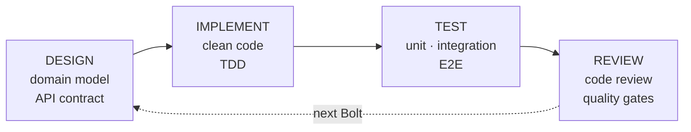
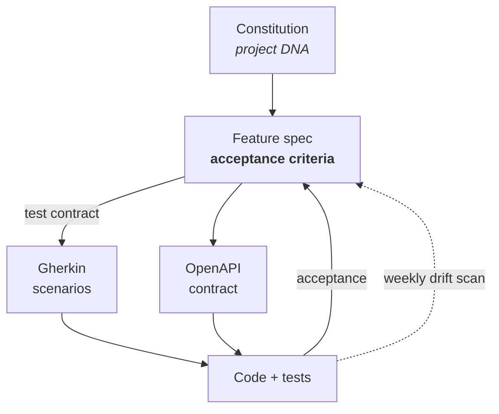

<!--
Opening frame, 30 seconds:

"Bolt Framework is how we make AI-assisted delivery repeatable. Not a tool — a
methodology, with the governance, the artifacts and the gates already built."

Everything in this deck is sourced from the framework repository. There are no
invented metrics: where you see a number, it is either a threshold the framework
enforces or a count I verified on disk. The two external market figures are
attributed on the slide.
-->

---
title: The problem Bolt Framework solves
subtitle: AI made writing code fast. It did not make **delivering software** better.
---

  

    <h3>What AI gave us</h3>
    
~90%

    
of software professionals now use AI at work; over 80% say it makes them more productive.

    <ul>
      <li>Throughput is <strong>up</strong>: teams ship more, more often.</li>
      <li>Code generation is no longer the bottleneck.</li>
    </ul>
  

  

    <h3>What it cost us</h3>
    
40 pts

    
by how much developers overestimated AI's effect on their own time, against a randomised trial.

    <ul>
      <li>Delivery <strong>stability fell</strong> as throughput rose.</li>
      <li>Time saved comes back as <strong>verification and prompting overhead</strong>.</li>
      <li>More change failures, more rework, longer to resolve.</li>
      <li>Around <strong>30%</strong> report little or no trust in AI-generated code.</li>
    </ul>
  

The bottleneck moved. It is no longer "can we write the code?" — it is <strong>"can we trust it, and can we prove it does what was agreed?"</strong> DORA's own reading is that the outcome depends less on the tool than on <strong>the system it runs inside</strong>: acceleration does not create weaknesses downstream, it exposes them. Supplying that system — the gates, the contracts, the harness — is what Bolt Framework is for.

External figures: <strong>DORA / Google Cloud, 2025 State of AI-assisted Software Development</strong> — dora.dev/insights/balancing-ai-tensions — and <strong>METR</strong> (11 May 2026) for the self-report gap, measured against its own randomised controlled trial. Quoted as market context, not as Bolt Framework results.

<!--
Land the DORA finding precisely: AI adoption correlates with HIGHER throughput
and LOWER stability. The bullets in both panels are DORA; the two headline
figures are deliberately from different sources, and the pairing is the point —
the left is what developers SAY (self-report), the right is what a randomised
trial MEASURED against that self-report. People overestimated the effect on
their own time by 40 percentage points.

That is why the rest of this deck argues from enforced gates and thresholds
rather than from anybody's reported productivity gain — including ours.

The conclusion is now printed on the slide, so do not read it out. Spend the time
making it concrete instead: what decides which of the two panels a team lands in
is whether it has a delivery harness. That is the thread picked up on slide 3
("that pace needs solid CI/CD") and spelled out for delivery leads on slide 11 —
where the honest advice is to keep the Bolts and wrap them in very short Sprints
until the client's CI/CD can take the cadence.

If challenged on the numbers: they are DORA's, attributed on the slide, and they
describe the market — they are not Bolt Framework results.
-->

---
title: What Bolt Framework is
subtitle: An AI-native development methodology — not a tool, not a prompt library
---

"A modular, practice-based AI-native development methodology … with intelligent micro-iterations called <strong>Bolts</strong>, orchestrated by specialized AI agents."

  

    
<AvanadeIcon prefix="Agile" layout="Orange" :size="64" width="44" />

    <h3>Bolts: days, not weeks</h3>
    
A Bolt is a <strong>2–3 day micro-iteration</strong> ending in working, tested code; 4–6 per feature. That pace needs solid CI/CD — without it, we run Bolts inside very short Sprints.

  

  

    
<AvanadeIcon prefix="GovernanceCompliance" layout="Orange" :size="64" width="44" />

    <h3>A Constitution that is law</h3>
    
19 articles fixing stack, architecture, quality and security. Agents must read it, validate against it and <strong>fail</strong> on violation.

  

  

    
<AvanadeIcon prefix="ArtificialIntelligence" layout="Orange" :size="64" width="44" />

    <h3>A staffed agent team</h3>
    
<strong>51 specialised agents</strong> and 114 skills covering all six lifecycle phases — from RFP analysis to decommissioning — plus four that run across every phase: <strong>security, dependencies, docs, templates</strong>.

  

  

    
<AvanadeIcon prefix="Tools" layout="Orange" :size="64" width="44" />

    <h3>Dual-client by design</h3>
    
One methodology definition, two clients: <strong>GitHub Copilot and Claude Code</strong> read the same artifacts. No per-tool rewrite.

  

The deliverable is not only working software — it is an <strong>operating model the client's own team can keep running</strong>: the same artifacts, the same gates, in their repository, with their tooling.

Counts verified on disk at framework <code>v1.0.0</code>. Bolt Framework credits <strong>AWS AI-DLC</strong>, Domain-Driven Design and Clean Architecture as antecedents.

<!--
The key reframe for any audience: Bolt does not make the AI smarter. It changes
what the AI is allowed to do, in what order, and what it must produce before it
is permitted to continue.

If asked "is this just a prompt library?" — no. The prompts are the thin part.
The substance is the constitution, the phase gates, the artifact contracts and
the handoff matrix.
-->

---
title: The lifecycle — six gated phases
subtitle: Each phase produces **one named artifact** — that is what makes it auditable
---

  

    <h3 style="font-size:0.76rem;">1 · INCEPTION</h3>
    
Define the project DNA.

    
<code>constitution.md</code>

  

  

    <h3 style="font-size:0.76rem;">2 · DISCOVERY</h3>
    
Turn intent into specs.

    
<code>specs/…/feature.md</code>

  

  

    <h3 style="font-size:0.76rem;">3 · CONSTRUCTION</h3>
    
Build and test in Bolts.

    
<code>planning/tasks.md</code>

  

  

    <h3 style="font-size:0.76rem;">4 · TRANSITION</h3>
    
Release and document.

    
<code>CHANGELOG</code> + tag

  

  

    <h3 style="font-size:0.76rem;">5 · PRODUCTION</h3>
    
Operate and improve.

    
runbook · dashboards

  

  

    <h3 style="font-size:0.76rem;">6 · RETIREMENT</h3>
    
Decommission cleanly.

    
decommission plan

  

  

    
Phases are gated, not suggested

    <ul class="bf-list">
      <li>Every phase declares <strong>entry and exit criteria</strong>. DISCOVERY cannot exit without approved specs; CONSTRUCTION cannot start without a task breakdown.</li>
      <li>A <strong>handoff matrix</strong> makes illegal transitions explicit: plan → implement is refused, because it skips task breakdown.</li>
    </ul>
  

  

    
Inside CONSTRUCTION: the Bolt

    

    
Each Bolt runs on its own branch and must clear the full quality gate before it can be called done.

    
The gate is only as fast as the pipeline that runs it. At this cadence <strong>CI/CD stops being a nicety</strong> — where a client's pipeline cannot validate an increment in hours, the Bolts stay and the Sprint around them gets very short.

  

<!--
The two things to stress here:

1. The artifact row. Each phase has ONE named deliverable. That is what makes the
   methodology auditable — you can walk into any Bolt project and ask "show me
   the constitution, show me the spec, show me the tasks."

2. The gates. This is what distinguishes Bolt from a workflow diagram. The phases
   are not a picture of good intentions; the transitions are refused when the
   entry criteria are not met.

Only if someone asks about the "eight cognitive stages" in the framework README:
perceive, analyze, reason, plan, execute, validate, adapt, reflect. They are a
vocabulary for the kind of thinking a step demands — not a gate, and not wired
into the agents. Only 4 of the 24 prompts declare a stage (business-analysis →
PERCEIVE, domain-modeling → ANALYZE, code-generation → EXECUTE, test-generation
→ VALIDATE). Deliberately kept off the slide: it cannot be explained in one line,
and it is the one item on this page that nothing enforces.
-->

---
title: Specs before code — enforced, not encouraged
subtitle: The **acceptance criteria** are the contract — they drive the tests, the code and the sign-off
---

  

    
The traceability spine

    

  

  

    
Five mechanisms that make it stick

    <ul class="bf-list">
      <li><strong>Acceptance criteria are the test contract.</strong> Every spec carries them, classified <code>@smoke</code>; they become the Gherkin the build is verified against, and the basis on which the feature is accepted.</li>
      <li><strong>Phase gates.</strong> No spec, no construction. Exit criteria are checked, not assumed.</li>
      <li><strong>Every feature has a ticket.</strong> Creating it is mandatory — GitHub Issue by default, Jira or Azure Boards where the client works there — and its id is recorded in the spec, so spec, branch, commits and PR resolve to one thread.</li>
      <li><strong>Drift analysis.</strong> A dedicated agent cross-checks every spec entity to its data model, DTO, endpoint and test — and flags orphan code.</li>
      <li><strong>CI enforcement.</strong> A scheduled workflow scores spec-to-code drift <strong>0–10</strong> every week and opens a labelled issue when it finds any.</li>
    </ul>
    

      The framework's own words: <strong>"Specs Before Code"</strong> and <strong>"Constitution is law — never violate its constraints."</strong>
    

  

<!--
This is the slide that answers "how is this different from just telling Copilot
to read a spec first?"

The answer is the dotted line on the diagram. Anyone can write a spec. What is
rare is a system that keeps checking, after the fact and on a schedule, whether
the code still matches it — and that raises a tracked issue when it does not.

If a technical audience pushes: the drift scan classifies findings as implemented
correctly, partially implemented, not implemented, orphan code, and assigns an
overall drift risk score from 0 to 10.
-->

---
layout: default-2
title: Advantages across the SDLC
subtitle: What the framework contributes at each phase — and the gate that closes it
---

::left::

What Bolt adds, phase by phase

| Phase | What you get that you didn't have |
|---|---|
| Inception | A ratified constitution: stack, architecture, quality and security decided **once**, explicitly, machine-readable |
| Discovery | Specs, use cases, Gherkin and OpenAPI contracts as a **connected set**, not separate documents |
| Construction | 2–3 day Bolts on their own branches, TDD red/green/refactor agents, and a gate that blocks merge |
| Transition | Semantic-version releases with changelog, deployment guide and release notes from templates |
| Production | Runbooks, observability config, postmortems and improvement proposals as artifacts |
| Retirement | A decommission plan with impact analysis, data handling and sign-off — the phase most methods omit |
| Cross-phase | Status and alignment reports, security and dependency analysis, docs — plus an ADR whenever a decision is taken, in any phase |

::right::

The gate every Bolt must clear

| Check | Threshold |
|---|---|
| Linting | 0 errors |
| Unit tests | 100% pass |
| Line coverage | ≥ 80% |
| Branch coverage | ≥ 75% |
| Mutation score | ≥ 70% |
| Architecture tests | 100% pass |
| Code review | Approved |
| Constitution compliance | Pass |

  <h3>Modernization adds one more</h3>
  
An <strong>equivalence gate</strong>: ≥ 95% parity against the legacy system and <strong>100%</strong> of priority-zero behaviour characterised by tests — before anything is switched over.

<strong>Enforced thresholds, not measured outcomes</strong> — the framework calls this a "non-optional checkpoint: no PR merge without passing gates".

<!--
Be precise about the right-hand column if challenged: these are gate thresholds
the framework imposes, not results it has demonstrated. That distinction is the
difference between a credible claim and an unprovable one — and it is the honest
answer, which is also the more persuasive one with an engineering audience.

The retirement row is worth pausing on. Very few delivery methodologies have
anything to say about switching a system off. Bolt has an agent, a template and
a script for it.
-->

---
title: Where it applies
subtitle: Five documented entry points — greenfield is only one of them
---

  

    
<AvanadeIcon prefix="Innovation" layout="Orange" :size="64" width="40" />

    <h3>Greenfield</h3>
    
An idea or a blank repository. Constitution first, then specs, then Bolts.

  

  

    
<AvanadeIcon prefix="Migration" layout="Orange" :size="64" width="40" />

    <h3>Brownfield</h3>
    
COBOL, VB6, legacy .NET or Java. Analyse, characterise, then modernise behind an equivalence gate.

  

  

    
<AvanadeIcon prefix="Handshake" layout="Orange" :size="64" width="40" />

    <h3>From a requirement</h3>
    
An RFP or tender. Extract the requirements, then produce architecture, plan and estimate — before anyone commits.

  

  

    
<AvanadeIcon prefix="Assessment" layout="Orange" :size="64" width="40" />

    <h3>Discovery only</h3>
    
Understand and document a domain or system. Models, specs and decision records — no code. The gate is human: <strong>a named expert signs it off</strong>.

  

  

    
<AvanadeIcon prefix="Agile" layout="Orange" :size="64" width="40" />

    <h3>Single feature</h3>
    
An existing Bolt project. Add one feature through the full spec-to-review chain.

  

  

    
One framework, configured per engagement

    
A <strong>practice</strong> — Apps &amp; Infra, Data &amp; AI, CRM or Custom — activates only the areas the work needs, each with its own slice of the governing document, skills and tooling. Nothing is forked per project. Highlighted: Apps &amp; Infra.

    

      backendfrontendcloud-platformwork-managementcommondataaiintegration
    

  

  

    
And it adapts to the shape of the work

    
The framework detects the shape of the work — back end only, front end only, infrastructure only, or full stack — and changes what it produces: an infrastructure project is never asked for a domain model or an API contract.

    
Backend stack templates ship for <strong>.NET, Node.js/NestJS, Python/FastAPI and Go</strong>.

  

<!--
The point of this slide is to kill the assumption that this is a greenfield toy.
Three of the five entry points are about systems or commitments that already
exist — brownfield, RFP, and discovery-only.

Note the honest boundary if asked: the data, AI and CRM scopes have constitution
definitions and MCP tooling, but their plugin content is not yet packaged — it is
still sourced externally. Apps & Infra is where the depth is today.
-->

---
title: Custom development
subtitle: When code stops being the constraint, what the client is buying changes
---

Code is no longer the constraint — what the client buys is <strong>definition and verification</strong>, validated <strong>as we go</strong> rather than at the end.

  

    
<AvanadeIcon prefix="Document" layout="Orange" :size="64" width="40" />

    <h3>Turnkey — fixed scope</h3>
    <ul>
      <li>Needs a <strong>detailed definition phase</strong> up front: features, use cases and acceptance criteria — each one becoming an executable test.</li>
      <li>The spec <em>is</em> the contract, and drift from it is <strong>scored weekly</strong> — not discovered at UAT.</li>
      <li>Effort, cost and a go/no-go scorecard come from the RFP path.</li>
      <li><strong>Watch:</strong> a spec error, once signed off, becomes contractual scope.</li>
    </ul>
  

  

    
<AvanadeIcon prefix="Agile" layout="Orange" :size="64" width="40" />

    <h3>Agile — evolving scope</h3>
    <ul>
      <li>Course changes happen <strong>between Bolts, not inside one</strong> — two to three days is the smallest unit of committed work, so changing direction costs days.</li>
      <li>Re-prioritise freely: the constitution and the quality gates do not move, so speed never comes out of quality.</li>
      <li>Right while requirements are still moving, or the domain is being discovered with the client.</li>
    </ul>
  

  
<strong>What decides:</strong> requirement stability, and who carries scope risk. Spec-driven delivery makes fixed price <strong>more governable than usual</strong> — scope is written as tests before anyone commits — but only if the definition phase is funded.

<!--
Provenance, moved off the slide so the page is shareable with a client: both
commercial models are Avanade practice. Bolt documents neither of them — what
Bolt supplies is the definition machinery that makes fixed price governable.
Keep that straight if challenged.

This is the pre-sales slide that does commercial work, so be precise about
which half is ours and which half is Bolt's.

Bolt's half is repo-sourced even though the slide no longer lists it: acceptance
criteria as executable tests (bolt-feature), effort and cost estimation with a
go/no-go scorecard (rfp-analysis-template), and weekly spec-to-code drift
scoring (spec-drift). The two delivery models are Avanade
practice — the framework has nothing to say about pricing, and if someone
asks "where is that in the framework?", the honest answer is that it is not,
and does not need to be.

The argument worth making out loud: spec-driven delivery suits fixed price
better than most methods do, because the acceptance criteria are written as
tests before commitment and the drift scan keeps checking the built system
against them. That inverts the usual objection to turnkey.

The counter-argument to have ready: it only works if the client pays for the
definition phase. A fixed price over a thin specification is the same bad deal
it has always been — Bolt makes the spec verifiable, not free.

Do not promise a client demo every two to three days without checking their
pipeline first. That caveat is on slides 3, 4 and 11, and stated without
jargon on slide 10.
-->

---
title: One-pager — Business developers
subtitle: What Bolt Framework lets you put in front of a client, and defend
---

  

    
What you can promise credibly

    <ul class="bf-list">
      <li><strong>A scope you can price.</strong> Before commitment, the RFP path produces requirements, technical assessment, risk analysis, a go/no-go scorecard and a costed estimate — on <strong>your</strong> model: Bolt structures the inputs, not the maths.</li>
      <li><strong>Quality written into the proposal.</strong> Coverage, mutation and architecture thresholds are numeric and enforced, so "high quality" stops being an adjective.</li>
      <li><strong>Modernization without a leap of faith.</strong> Legacy behaviour is characterised by tests first; nothing is rewritten until parity is proven.</li>
      <li><strong>A decision trail.</strong> Every architectural choice becomes an ADR the client can read.</li>
    </ul>
  

  

    
Why this beats "we use AI too"

    <ul class="bf-list">
      <li>Everyone has copilots. <strong>Almost nobody has governance</strong> — a constitution that agents are obliged to obey and fail against.</li>
      <li><strong>51 agents, 114 skills, 22 artifact templates</strong> spanning RFP analysis to decommissioning — an operating model, not a tool licence.</li>
      <li><strong>Client-tool agnostic.</strong> Works with GitHub Copilot or Claude Code from one definition, so the client's existing licence is not an obstacle.</li>
      <li><strong>Nothing proprietary is left behind.</strong> Specs, ADRs and plans are plain Markdown in the client's own repository.</li>
    </ul>
  

  

    
How to use it in a pursuit

    <ul class="bf-list">
      <li><strong>Qualify before you propose.</strong> Business discovery ends in a triage over four paths: Power Platform and M365 <strong>close the case with no build</strong>; only a Bolt team or autonomous Copilot opens a repository.</li>
      <li><strong>Run the RFP path early</strong> to produce the solution outline and estimate that becomes your response.</li>
      <li><strong>Bring an SME in.</strong> Request repository access via the framework's access process; the Bolt SME team approves and onboards.</li>
    </ul>
  

  
<strong>Say this, not that.</strong> Claim the mechanism — gates, contracts, audit trail. Never a percentage: there is no published Bolt figure, and inventing one loses evaluators.

<!--
This page is designed to be handed over on its own.

The last card matters most. Pre-sales pressure produces invented numbers, and a
client-side architect will ask where the number came from. The defensible pitch
is structural: here is what the framework refuses to let a team skip.
-->

---
title: One-pager — Customers
subtitle: What changes in how your software gets built, and what you can hold us to
---

  

    
What changes

    <ul class="bf-list">
      <li><strong>The specification becomes the contract</strong> — written, agreed and versioned before code exists, not reconstructed afterwards.</li>
      <li><strong>Decisions are made once, in the open.</strong> Your stack, architecture, quality and security rules are ratified up front in a document you sign off.</li>
      <li><strong>Work arrives every few days</strong> as tested, reviewed increments, not one delivery after a long silence. How fast depends on your pipeline: without automated build and release we start with short cycles and tighten them as it matures.</li>
      <li><strong>AI is used under supervision</strong>, inside rules you approved, with a record of what it did.</li>
      <li><strong>Drift is detected, not discovered.</strong> A weekly check reports where the code has diverged from what was agreed.</li>
    </ul>
  

  

    
What you can hold us to

    <ul class="bf-list">
      <li><strong>Agents must obey the rules you signed.</strong> They must read the governing document, validate against it, <strong>fail</strong> rather than proceed on a violation, and log every check for audit.</li>
      <li><strong>Every architectural decision is recorded</strong> — dated, with the alternatives considered.</li>
      <li><strong>Quality is numeric</strong>, not editorial: coverage, mutation and architecture thresholds block a merge.</li>
      <li><strong>Security and compliance are in scope by default</strong> — OWASP Top 10, plus GDPR, HIPAA, SOC 2 and PCI-DSS checklists.</li>
      <li><strong>Humans approve what matters.</strong> Production deploys need manual approval; modernization stops at five checkpoints.</li>
    </ul>
  

  

    
What we need from you

    <ul class="bf-list">
      <li><strong>Stakeholder time early.</strong> The inception and discovery phases need decisions from people who can make them.</li>
      <li><strong>Sign-off on the governing document.</strong> It is the reference every agent and engineer works against.</li>
      <li><strong>A named owner for exceptions.</strong> Amendments require review and approval — deliberately.</li>
    </ul>
    

      <h3>No lock-in</h3>
      
Specifications, decisions, plans and tests are plain Markdown and standard formats in <strong>your</strong> repository. If we stop working together tomorrow, everything that describes your system stays with you — and so does <strong>the way of working</strong>: your team can keep running the same method.

    

  

<!--
End-to-end traceability, if they ask how the guarantees are actually wired:
spec → work item → branch → commits → PR → pipeline → tagged release, with
every state transition logged. (Kept as a note rather than on the slide — this
page is already full, and slide 5 shows the same chain as a diagram.)

Read the room on vocabulary here — this page deliberately avoids "Bolt",
"agents" as jargon, "scopes" and "constitution". A customer cares about three
things: what changes for them, what guarantees they get, and what it costs them
in time and attention.

The strongest line on the page is "fail rather than proceed on a violation".
That is the one thing an AI-sceptical client is not expecting to hear.

If asked about the AI trust question directly, the DORA figure from slide 2 is
the honest framing: scepticism is warranted, which is exactly why the gates and
the audit log exist.
-->

---
title: One-pager — Delivery leads
subtitle: The operating model, the definition of done, and what you get for free
---

  

    
Operating model

    <ul class="bf-list">
      <li><strong>The Bolt is the unit of delivery.</strong> 2–3 days, 4–6 per feature, 15–25 tasks, no task over a day.</li>
      <li><strong>The cadence assumes a harness.</strong> An increment every 2–3 days needs solid CI/CD. Without it, keep the Bolts and wrap them in <strong>very short Sprints</strong>.</li>
      <li><strong>One branch per Bolt</strong>, created from and merged back to the feature branch. Mandatory, and scripted.</li>
      <li><strong>Phase entry/exit criteria are your gate list</strong> — the closest thing to a definition of done, and it is explicit per phase.</li>
      <li><strong>Re-sizing is a rule, not a judgement call.</strong> Below 70% of planned velocity for two consecutive Bolts, you must recalibrate sizing.</li>
    </ul>
  

  

    
Control and visibility

    <ul class="bf-list">
      <li><strong>Six metrics defined with cadence</strong>: Bolt velocity, feature lead time, cycle time (weekly), WIP limit, dependency health (daily), traceability coverage.</li>
      <li><strong>Azure DevOps sync, both directions.</strong> Specs map to Epics, Stories and Tasks; iterations to Bolts; commits link by <code>AB#</code> id.</li>
      <li><strong>Reporting from templates</strong>: status report with RAG and budget; alignment report scoring business-technical fit, with requirement-to-test traceability and sign-off.</li>
      <li><strong>Conflict rule is pre-agreed</strong>: the spec owns requirements; the work-management tool owns scheduling and effort.</li>
    </ul>
  

  

    
Adoption and honesty

    <ul class="bf-list">
      <li><strong>Two steps to onboard</strong>: run the init script to pick practice and scopes, then the constitution agent to provision and merge. PowerShell and Bash at parity.</li>
      <li><strong>The framework is itself engineered</strong>: 160 automated tests, a 14-job CI pipeline, 17 workflows, 62 automation scripts, code owners on every path.</li>
      <li><strong>Gap — estimation.</strong> Bolt sizes work and forces recalibration but supplies <strong>no</strong> estimation model. Bring your own.</li>
      <li><strong>Gap — uneven depth.</strong> Apps &amp; Infra is deep today; Data, AI and CRM have scope definitions but little packaged content.</li>
    </ul>
  

Framework <code>v1.0.0</code> (2 Sep 2026), actively developed. Dogfooded: this repository's own commits carry <code>AB#</code> work-item links.

<!--
The third column is the one that earns trust with a delivery lead. Anyone can
present a capability list; naming the two real gaps — no estimation model, and
uneven scope depth — is what makes the rest believable.

If asked "what does this actually cost me to adopt?": two scripted steps plus
the stakeholder time for the constitution interview. The interview is the real
investment — it front-loads roughly 17 irreversible decisions so they are not
made by accident later.
-->

---
title: What efficiency to expect
subtitle: An analyst benchmark, segmented — an expectation, not a commitment
---

  
25–30%

  

    <strong>across the lifecycle</strong> — the analyst benchmark for applying AI beyond coding, against the <strong>~10%</strong> typically seen where it is used for code alone. Bolt Framework is <strong>built to reach it</strong>.
  

  

    
Where the gain concentrates

    

| Work | Realistic band |
|---|---|
| Greenfield, well-specified features | Upper end — no figure published until verified |
| Rework and verification overhead | Material — this is Bolt's mechanism |
| Brownfield, high-complexity legacy | 0–15% |

    
Saying the third row out loud is what buys the first: a single blended number swings by <strong>4×</strong> between the top row and the bottom one. Where we cannot cite a figure, <strong>we do not print one</strong>.

  

  

    
What the band assumes

    <ul class="bf-list">
      <li>A working <strong>CI/CD harness</strong>, automated tests with a usable coverage baseline, version-control discipline and small batches.</li>
      <li>AI-accessible internal documentation, and an <strong>agreed baseline</strong> taken before we start.</li>
      <li>Where these are missing, the first Bolts build them — the gain then lands <strong>later and lower</strong>. Expect a <strong>J-curve</strong> before the curve.</li>
      <li>Measured by <strong>first-pass acceptance rate</strong>, never by coding throughput.</li>
    </ul>
  

<strong>Gartner</strong>, <em>How to Capture AI-Driven Productivity Gains Across the SDLC</em> (11 Apr 2025) — 25–30% by 2028 across the SDLC vs ~10% code-focused. Segmentation: <strong>Stanford</strong> (Denisov-Blanch) and <strong>McKinsey</strong>. J-curve: <strong>DORA</strong> ROI report 2026.01. Measurement: <strong>Thoughtworks Technology Radar</strong> Vol. 34, which places coding throughput in <em>Caution</em>. <strong>Indicative expectation, never contractual</strong> — Bolt Framework publishes no efficiency measurement of its own.

<!--
The most dangerous slide in the deck. Three rules for presenting it:

1. It is an EXPECTATION, never a promise, and never a contractual commitment.
   The wording is "built to reach it", not "delivers". If someone tries to write
   a number into a contract off this slide, stop them.

2. Lead with the third row of the table, not the first. Brownfield high-complexity
   is 0-15% — Stanford has it at 0-10%, McKinsey under 10%. Volunteering the weak
   case is what makes the strong case believable, and every technical evaluator in
   the room already knows the weak case exists.

3. "From 30%" is the phrasing to avoid. Gartner's 25-30% is a 2028 CEILING for
   teams applying AI across the whole lifecycle; "from" would convert the market's
   optimistic maximum into our guaranteed minimum. "Up to" survives an
   under-performing engagement; "from" becomes a broken promise.

If challenged: "what is Bolt's own number?" — we do not have one, and we will not
borrow someone else's and put our name on it. Neither Avanade nor Accenture
publishes an engineering-efficiency percentage; Avanade has argued in print
against the measure. What we can show is the mechanism, which is the rest of
this deck. Full evidence base, including the counter-evidence and the answer to
each objection, is in research/efficiency-evidence.md.
-->

---
layout: breaker
title: An operating model, not a tool
subtitle: It transfers with the work — the specifications, decision records and tests stay in **your** repository, readable without us. **Next step:** request access through **REQUEST-ACCESS.md**; the Bolt SME team reviews and onboards.
---

<!--
Close on the commitment, not a recap — the through-line was already stated on
slide 2 and does not need repeating.

Both sentences are now printed, so do not read them out. Say the thing that is
not on the slide: what transfers is the operating model, so the client's own
team can keep running it after we leave — that is what separates this from a
tool licence.

The CTA on the slide is the INTERNAL one (request repository access). Running
this for a client audience, replace it out loud with the engagement next step —
an assessment to establish the baseline — and do not read the access route.

Refresh note: this deck is generated from a specific framework commit. See
REFRESH.md for the slide-to-source map and how to bring it up to date, and
research/efficiency-evidence.md before anyone writes a new number on a slide.
-->

---
title: Higher education — VB6 migration
subtitle: The engagement Bolt Framework came out of
---

  

    
Appendix · 1 of 3Delivered · in maintenance

    
DISCOVERYCONSTRUCTIONPRODUCTION

    
Problem

    
A VB6 enrolment system had to be replaced. The functional knowledge that defined it lived with its users rather than in any documentation — so the specification did not exist to be migrated.

    
Solution

    
Bolt's legacy agents read the source, the documentation and the database to recover the schema and the business rules, written as Given/When/Then — which became the tests the rebuild was checked against. The rebuild then ran as governed Bolts: .NET 8 microservices over Oracle, Clean Architecture with domain events, and an Angular 16 front end on Atomic Design. The same process now runs corrective and evolutive maintenance.

    
<strong>The functional knowledge exists in writing again</strong> — the system no longer depends on who is still in the building. It runs on Azure, scaling up for enrolment peaks and back down in the off-season.

  

  

<strong>What it cost:</strong> part of the framework was being built at the same time as the project was delivered. Client anonymised.

<!--
Lead with what this one is: the engagement the framework was extracted from. That
answers the timeline question before anyone asks it — a full VB6 to .NET 8
rebuild cannot fit inside a framework released in May 2026, and the answer is
that the project came first and the methodology came out of it.

It is also a stronger claim than "we used our framework here": Bolt was not
invented in a workshop and then given somewhere to live.

Own the obvious objection yourself — a framework validated on the engagement
that produced it is not independent evidence. That is what the next two slides
are for.

If challenged on behaviour preservation: the recovered rules are written as
Given/When/Then and became the tests the rebuild was checked against. Do not
claim the formal equivalence-gate thresholds — we have no parity figure.
-->

---
title: Automotive — support agent
subtitle: Constitution to production, on its own stack and toolchain
---

  

    
Appendix · 2 of 3In production

    
INCEPTION→ PRODUCTIONfull lifecycle

    
Problem

    
A vast, highly heterogeneous dealership network generated more support tickets than the team could absorb. Lead times stretched badly, and reopened and reassigned tickets were a large part of the cost.

    
Solution

    
An end-user agent that guides people as they raise ServiceNow requests, so tickets arrive correctly formed and stop bouncing between support teams. Built greenfield under Bolt from the constitution onwards: microservices in Python and Node.js with a React front end, <strong>Azure AI Foundry</strong> as the agent platform, a <strong>ServiceNow</strong> integration, and Azure DevOps work-item sync. Bolts ran inside a three-week coordination cycle.

    
<strong>From zero definition to production in four months, with a team of four.</strong>

  

  

<strong>What it cost:</strong> response-time commitments force the team to balance project work against support load. Client anonymised; the four-month figure is a delivery fact about one engagement, not a benchmark.

<!--
This is the transfer case, and the most important of the three. It differs from
the origin engagement on every axis that matters: different sector, greenfield
instead of migration, Python/Node/React instead of .NET/Angular, Azure DevOps
instead of GitHub. It is the evidence the framework is not welded to where it
was born.

It is also the only reference covering the whole lifecycle — constitution
through production — which is the claim slide 4 makes.

On the four months with four people: state it and stop. Let the room do its own
arithmetic. If asked "compared with what?", the team's judgement is that it
would have needed more people and more months — say that as a judgement, never
as a measurement, and never attach a multiple or a percentage. There is no
control project and no baseline.

Two things confirmed in use here that appear nowhere else in this deck: the
azdo-sync skill, and the four bug agents — tracker, troubleshooter,
regression-test and fixer. The team is now adapting that triage, root-cause and
impact-analysis flow to the client's needs.

On the three-week cycle: the Bolts ran inside it, and the cycle length came
from internal coordination — not from a client pipeline that could not take the
cadence. Do not present it as proof of the CI/CD caveat on slides 3 and 11.
-->

---
title: Banking — a client-owned SDLC
subtitle: In flight — the framework as someone else's standard
---

  

    
Appendix · 3 of 3Underway

    
INCEPTION — enterprise-wide

    
Problem

    
Development is spread across internal teams and a supplier ecosystem with no common process. The bank wants one AI-supported SDLC that applies to both — and wants to <strong>own it</strong>, not rent it.

    
Solution

    
Bolt Framework as the base for that process, adapted to the bank's own tools, requirements and controls, on GitHub end to end. Delivered jointly with Accenture, starting from the client's VDI setup and continuing into the definition of the AI-supported SDLC flow itself.

    
The target is <strong>the bank's own</strong>: efficiency in time-to-market and cost, assessed at one and two years. That is the client's objective, not a Bolt result.

  

  

<strong>What it cost:</strong> every step is audited and reviewed with security. The flow is agreed and clear, but progress moves at the pace review allows. Client anonymised; cleared for anonymous reference.

<!--
Nothing has been delivered here yet, and the status chip says so. Do not let it
be heard as a third success story.

Its value is different, and it is the closing slide made literal: the bank will
OWN the process and extend it to its own suppliers. Slide 13 promises that the
operating model transfers. Here a bank is doing exactly that, which is a
stronger proof than any argument on slide 3.

It also completes the toolchain spread across the three references — GitHub
Copilot, Azure DevOps, and now GitHub end to end.

On the efficiency target: it is the bank's own objective, measured on the bank's
own baseline, and it belongs to them. One- and two-year horizons mean nothing
usable before 2027, so slide 12 stays on the Gartner anchor. If this programme
does measure, it would be the first engagement capable of producing a
defensible Bolt efficiency figure — and the figures would need the bank's
permission to cite.
-->
