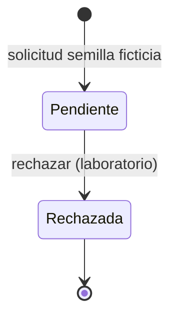

# Modelo de estados: rechazo de solicitudes

| Propiedad | Valor |
| --- | --- |
| Feature | F-006: Rechazo de solicitudes |
| Estado | Draft; modelo bloqueado para definir una transición completa |
| Escenario | fullstack (Vue.js, versión sin fijar; backend C#/.NET 8) |
| Historia | US-001: Rechazar una solicitud |

## Alcance y fuentes

Este documento distingue la acción de rechazo nombrada de una transición de estado formal. El actor
autorizado, estado de origen y efecto de rechazo no están definidos; PA-06 y PA-14 siguen abiertas.

Fuentes funcionales activas: [F-006](requirements.md), [UC-008](use-cases/UC-008-rechazar-solicitud.md),
[baseline](../../../origin/Requirements-Baseline-Vacation-Management.md) (BL-RF-006, BL-RF-014,
BL-RF-016, BL-RF-046, BL-RF-048) y [RFP](../../../origin/RFP-Vacation-Management.md)
(PA-06/PA-14/PA-26).

## Estados documentados

| Categoría | Estado respaldado | Evidencia y límite |
| --- | --- | --- |
| Inicial | No definido. | Ninguna fuente dice desde qué estado se permite rechazar. |
| Intermedio | No definido. | «Valorar» no está definido como estado ni como paso intermedio. |
| Final | No definido como estado formal. | Las fuentes nombran la acción de rechazar, pero no establecen etiqueta, terminalidad, reversión o efecto posterior. «No aprobadas» (BL-RF-013) no resuelve esta semántica. |

## Transición candidata y bloqueo

| Origen | Evento/acción | Actor respaldado | Condición | Destino | Efectos externos | Trazabilidad | Validación |
| --- | --- | --- | --- | --- | --- | --- | --- |
| No definido | Rechazar una solicitud | Responsable; el rol concreto no está confirmado. RF-048 menciona responsable de proyecto, pero también incluye una acción «cerrar» no interpretada. | Estados permitidos, autoridad y relación entre rechazar, valorar y cerrar pendientes. | Resultado de rechazo mencionado en UC-008; no se define un estado formal ni su etiqueta. | No definidos. No se infiere notificación, motivo o efecto en otros niveles. | BL-RF-006, BL-RF-014, BL-RF-016, BL-RF-046, BL-RF-048; UC-008; PA-06/PA-14/PA-26. | Bloqueada: no se puede afirmar origen, transición persistida ni semántica completa hasta validar los términos y condiciones. |

## Diagrama

**No se incluye `stateDiagram-v2`.** Solo está respaldada la acción de rechazo; no hay par de estados
origen/destino ni reglas de transición suficientes. Dibujar `Rechazada` como estado formal o fijar
su origen convertiría una cuestión pendiente en decisión.

## Reglas respaldadas y preguntas pendientes

### Reglas expresadas por las fuentes

- El sistema debe permitir que un responsable rechace solicitudes (BL-RF-006/RF-016).
- No se propondrán alternativas en el proceso, aunque el alcance operativo exacto de esta regla debe
  mantenerse según RF-014.
- F-006 conserva una historia candidata en Draft; su criterio de aceptación está TBD.
- RF-048 contiene «rechazar o cerrar», pero el término «cerrar» no se interpreta como transición adicional.

### Pendiente de aclaración

- **PA-06:** significado de «valorar» y de «cerrar» frente al rechazo.
- **PA-14:** relación de cancelar, rechazar y cerrar, y estados/efectos permitidos.
- **PA-26:** responsable de validar las reglas.
- No se definen motivo, estado de origen, notificación, reversión o efecto sobre la aprobación por
  niveles. No se derivan de mockups ni de propuestas arquitectónicas.

## Modelo del laboratorio · Paso 16.2, Bolt 1

> Decisión DL-B1-03 confirmada por el usuario el 2026-10-30
> ([#74](https://github.com/jCabreraMartin/vacation-management/issues/74)). **Solo para el laboratorio**:
> no cierra PA-06/PA-14/PA-26 ni sustituye el análisis anterior. «Pendiente» y «Rechazada» son
> etiquetas del laboratorio; no se añaden otros estados (aprobación, cancelación o cierre).

| Origen | Acción | Actor | Condición | Destino | Efectos externos |
| --- | --- | --- | --- | --- | --- |
| Pendiente | Rechazar | «Responsable» implícito, sin autenticación (DL-B1-02) | Ninguna adicional | Rechazada (terminal) | Ninguno: sin notificación, motivo ni efecto en aprobación o ServiceNow. |
| Rechazada | Rechazar | Igual | — | Sin cambio: error de operación no permitida | Ninguno. |

El diagrama solo representa la decisión del laboratorio; el origen real de una solicitud no está
definido porque la presentación de solicitudes (F-012) no tiene requisito específico.