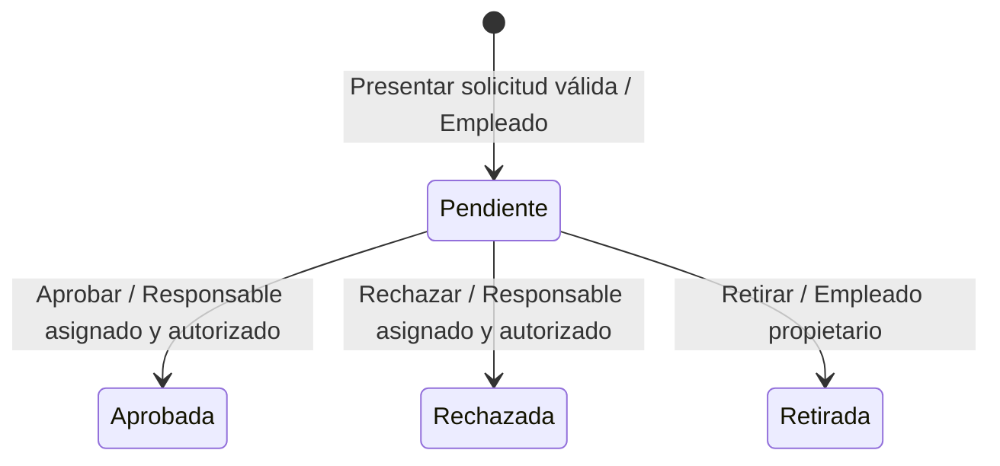

# Modelo de estados: Solicitud de vacaciones

> **Estado:** Borrador de laboratorio (`Draft / LAB-HYP`). No representa comportamiento aprobado
> del producto.
>
> **Alcance:** ciclo de vida hipotético descrito por la [baseline didáctica](../../lab/requirements-baseline.md),
> LAB-F005/UC-005, LAB-F006/UC-006 y LAB-F007/UC-007. No es el modelo de dominio completo.

## Concepto y estados

El concepto stateful modelado es la **solicitud de vacaciones**. Los artefactos nombran cuatro estados:

| Clasificación | Estado | Evidencia |
| --- | --- | --- |
| Inicial | `Pendiente` | FR-001 registra inicialmente la solicitud como pendiente. |
| Intermedio | Ninguno especificado | No se añade un estado intermedio. “En revisión” aparece como caso cuyo significado está pendiente, no como estado definido. |
| Final | `Aprobada` | FR-004 y LAB-F005/UC-005. |
| Final | `Rechazada` | FR-004 y LAB-F006/UC-006. |
| Final | `Retirada` | FR-005 y LAB-F007/UC-007. |

Los tres estados finales no tienen transiciones de salida en el ciclo mínimo propuesto por la
baseline. Esto no convierte las hipótesis en política aprobada.

## Tabla de transiciones

| Estado de origen | Estado de destino | Disparador | Actor autorizado indicado por la fuente | Condiciones y reglas expresas |
| --- | --- | --- | --- | --- |
| No creada | `Pendiente` | El empleado presenta la solicitud | Empleado | FR-001 indica fecha inicial y final, comentario opcional y estado inicial pendiente. FR-006 rechaza fechas ausentes o fecha final anterior a la inicial sin crear una solicitud pendiente. |
| `Pendiente` | `Aprobada` | El responsable aprueba la solicitud | Responsable aprobador autorizado para la solicitud de un empleado asignado | La solicitud existe y continúa pendiente; el responsable está autorizado y tiene asignado al empleado. El sistema registra el estado aprobado. |
| `Pendiente` | `Rechazada` | El responsable rechaza la solicitud | Responsable aprobador autorizado para la solicitud de un empleado asignado | La solicitud existe y continúa pendiente; el responsable está autorizado y tiene asignado al empleado. El sistema registra el estado rechazado. |
| `Pendiente` | `Retirada` | El empleado retira la solicitud | Empleado propietario de la solicitud | La solicitud es propia y continúa pendiente. Deja de aparecer como pendiente para el responsable y el empleado puede consultar el estado retirado. |

La tabla refleja únicamente condiciones expresas en las fuentes. No define precedencia, concurrencia ni
resolución de cambios de estado simultáneos.

## Diagrama de estados

`Presentar solicitud válida` se limita a los datos definidos por FR-001 y la validación expresa de
FR-006. No implica políticas de calendario adicionales.

## Transiciones no permitidas en este modelo

- No se registra una aprobación ni un rechazo si la solicitud ya no está pendiente o el responsable
  no está autorizado (UC-005 y UC-006).
- No se cambia a `Retirada` una solicitud que no esté pendiente (LAB-F007, AC-LAB-F007-02).
- La baseline no propone reabrir, editar ni revertir una solicitud después de una decisión. No se
  modelan transiciones desde `Aprobada` o `Rechazada`; la política definitiva sigue sin aprobarse.
- No se modelan otras transiciones de salida desde `Retirada` porque las fuentes no las especifican.
- No se modela `En revisión` como estado: UC-007 excluye la retirada mientras la revisión esté en
  curso, pero deja abierta la semántica de esa condición y su relación con `Pendiente`.

## Reglas de negocio expresas

- Una solicitud aceptada comienza en `Pendiente` (FR-001).
- El sistema no crea una solicitud pendiente cuando falta una fecha o la fecha final es anterior a la
  inicial (FR-006).
- Solo un responsable autorizado puede registrar la aprobación o el rechazo de una solicitud
  pendiente (FR-004, SEC-001, UC-005 y UC-006).
- El empleado puede retirar únicamente una solicitud propia que siga pendiente (FR-005, SEC-001,
  UC-007).
- La solicitud aprobada, rechazada o retirada deja de figurar como pendiente; el empleado puede
  consultar los estados resultantes de aprobación, rechazo y retirada según los artefactos citados.

## Confirmaciones, notificaciones e integraciones

UC-005 y UC-006 indican una confirmación del resultado al responsable; UC-007 indica una confirmación
de la retirada al empleado. La baseline también contempla confirmación al presentar una solicitud.
Los artefactos no especifican canal ni contenido, y no establecen notificaciones externas ni
integraciones para estas transiciones. No se infiere ninguna.

## Preguntas abiertas

- ¿Qué significa “en revisión” y es un estado distinto de `Pendiente`? ¿Qué debe suceder si el empleado
  intenta retirar una solicitud en esa situación? (LAB-OQ-006, LAB-F007, UC-007)
- ¿Quién determina y mantiene la asignación del empleado al responsable, y cómo se resuelven
  sustituciones o cambios de equipo? (LAB-OQ-003, UC-005, UC-006)
- ¿Qué mecanismo de identidad y autorización permite verificar que el responsable está asignado y que
  el empleado es propietario de la solicitud? (SEC-001, LAB-OQ-008)
- ¿Puede editarse, retirarse, reabrirse o revertirse una solicitud aprobada o rechazada? (LAB-OQ-006)
- ¿El rechazo requiere un motivo? Si se captura, ¿qué contenido y reglas aplican? (LAB-OQ-007,
  LAB-F006, UC-006)
- ¿Qué respuesta corresponde si el estado cambia durante la acción, hay decisiones concurrentes o
  falla el registro? (UC-005, UC-006, UC-007)
- ¿Qué canal y contenido tienen las confirmaciones ya mencionadas por los casos de uso? ¿Se requiere
  alguna notificación externa? (UC-005, UC-006, UC-007)

## Fuentes

- [Baseline didáctica](../../lab/requirements-baseline.md)
- [LAB-F005 — Aprobar una solicitud](requirements.md)
- [UC-005 — Aprobar una solicitud](use-cases/UC-005.md)
- [LAB-F006 — Rechazar una solicitud](../../lab-006-reject-vacation-request/requirements/requirements.md)
- [UC-006 — Rechazar una solicitud](../../lab-006-reject-vacation-request/requirements/use-cases/UC-006.md)
- [LAB-F007 — Retirar una solicitud pendiente](../../lab-007-withdraw-pending-vacation-request/requirements/requirements.md)
- [UC-007 — Retirar una solicitud pendiente](../../lab-007-withdraw-pending-vacation-request/requirements/use-cases/UC-007.md)